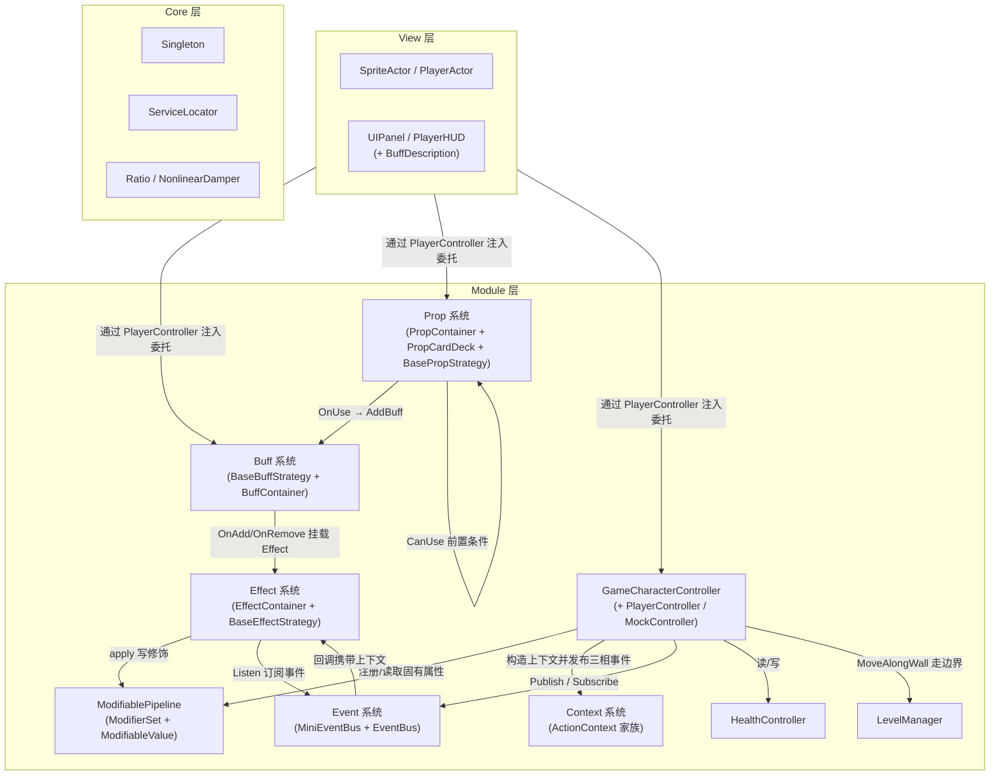

# Flicker — AI 开发指引

> 主策划案在 `Doc/主策划案.md`，手稿是设计初期 idea 不要看。
> 设计哲学在 `Doc/设计哲学.md`。
> 肉鸽子策划案在 `Doc/肉鸽地图系统策划案.md`。
> **没我主动邀请，请不要改动我的代码，我自己会写。**

---

## 项目概述

Flicker 是一款单人肉鸽闯关 / 双人实时对抗游戏。玩家操控史莱姆在两面竖直墙壁间上下移动、跳跃踩踏对手。核心玩法围绕道具博弈（7Bag 随机、信息差）、Buff/效果系统和藏品构筑。

目前处于 **PvP 原型阶段**，下一步接入 Mirror 做本地联机原型。

---

## 架构分层



---

## 目录结构

```
Assets/Scripts/
├── Core/                      # 框架基础设施
│   ├── Singleton.cs           # 泛型单例
│   ├── MiniEventBus.cs        # 实例级事件总线（角色行为事件）
│   ├── EventBus.cs            # 静态全局总线（UI 事件）
│   ├── Utils.cs               # 工具类（Ratio 比例换算 / NonlinearDamper）
│   └── ServiceLocator/        # 服务定位器（振动管理）
│
├── Module/                    # 核心游戏逻辑
│   ├── Buff/                  # Buff 系统
│   │   ├── BaseBuffStrategy.cs    # Buff 基类（元数据 + onAdd/onRemove 委托 + virtual 钩子）
│   │   ├── BuffContainer.cs       # Buff 计时器管理 + 三相事件 + UI 注入委托
│   │   └── BuffStrategies/        # 具体 Buff 实现
│   │       ├── AccelerateBuff.cs, ShieldBuff.cs, StiffnessBuff.cs
│   │       └── PropBuff/          # 道具卡专用 Buff（命名类，图标在 buff 栏显示）
│   │           └── StaticShell/   # 同一道具的多个 Buff 收进同名字文件夹
│   ├── CharacterController/   # 角色行为
│   │   ├── GameCharacterController.cs  # 实体行为基类（跳跃/移动/弹反/攻击/僵直/边界）
│   │   ├── PlayerController.cs         # 玩家输入 + UI 事件注入
│   │   └── MockController.cs          # 测试/AI
│   ├── Effect/                # 效果系统
│   │   ├── BaseEffectStrategy.cs  # 效果基类（apply/onAdd/onRemove 委托 + Listen 订阅助手）
│   │   ├── EffectContainer.cs     # 效果列表管理 + ForEachEffect + 迭代安全移除
│   │   └── EffectStrategies/      # 具体效果实现
│   ├── Event/                 # 事件系统
│   │   ├── CharacterEvent.cs      # 三相行为事件 + Buff/Prop 事件
│   │   ├── ActionContext.cs       # 行为上下文家族（ActionContext 及各行为子类）
│   │   ├── UIEvent.cs             # UI 层事件（道具/Buff 通知、描述框）
│   │   └── LevelEvent.cs          # 关卡事件（暂时未用）
│   ├── ModifiablePipeline/    # 修饰管线
│   │   ├── ModifiableValue.cs     # 可修饰属性（base + additives + multipliers，纯公式）
│   │   ├── ModifierSet.cs         # 实体固有属性集（enum Key + 字典，惰性补值）
│   │   └── ModifyPipeline.cs      # 管线结算入口
│   ├── PropCard/              # 道具卡系统
│   │   ├── BasePropStrategy.cs    # 道具基类（元数据 + 绑定 + CanUse/OnUse 钩子）
│   │   ├── PropContainer.cs       # 道具槽管理 + CD 冷却 + UI 注入委托
│   │   ├── PropCardDeck.cs        # 7Bag 随机抽卡
│   │   ├── PropFactory.cs         # 道具注册工厂
│   │   └── PropStrategies/        # 具体道具实现
│   ├── HealthController.cs    # 生命值数据
│   ├── GameManager.cs         # 全局玩家引用
│   ├── LevelManager.cs        # 关卡管理器（边界数据/门状态/关卡生命周期）
│   └── InputRouter.cs         # 输入路由
│
├── UI/                        # UI 框架
│   ├── UIManager.cs           # 面板堆栈管理
│   ├── UIPanel.cs             # 面板生命周期基类
│   ├── UILayer.cs             # 层级枚举
│   ├── PlayerHUD.cs           # 玩家 HUD（跳跃CD/道具槽/buff图标栏/描述框）
│   └── BuffDescription.cs     # Buff 图标 hover 描述（IPointerEnter/Exit）
│
└── View/                      # 视图层
    ├── SpriteActor.cs         # 精灵动画基类
    ├── PlayerActor.cs         # 玩家视图（动画监听）
    └── VibrationMgr.cs        # 振动服务
```

---

## 设计理念

### 快速失败原则

不为报错做软处理。传参越界、引用为空、类型不匹配——让它当场炸，不吞错、不静默降级。第一时间暴露、第一时间定位。

### 数据分类

| 类型                 | 实现                                                       | 适用                               |
| -------------------- | ---------------------------------------------------------- | ---------------------------------- |
| **可修饰属性** | `ModifiableValue`（baseValue + additives + multipliers） | moveSpeed, maxJumpingCD, damage 等 |
| **实体比例变量** | 裸 `float`（0~1），配 `Ratio` 工具类换算                | jumpCDRatio, propCDRatio           |
| **单次行为数据** | 行为上下文（见下节），数值字段用 `ModifiableValue`        | 本次伤害、本次僵直等               |

`ModifiableValue.FinalValue` 由 `ModifyPipeline` 每帧结算：清空 → 遍历所有 Effect → **加区汇总后统一相乘**。桶内归并保证结果与注册顺序无关（PoE 的 increased / more 模型）。

**可修饰数据只有浮点一种**。int 在读取点强转（`(int)Final(...)`），bool 只作为上下文参数存在、不参与修饰。

**冷却等"剩余量"存比例而非绝对值**：比例是上限的不变量，上限被修饰时无需任何同步，因此 `MutableValue` 与观察者机制已整体移除。

### 事件驱动：三相

每个行为拆为三个相位，**共用同一个上下文实例**：

```text
BeforeXxx(context)      询问：本次行为是否发生
  └ 订阅者可写 cancelled，置 true 则 return，后续相位都不发布

XxxResult(context)      询问：本次行为是什么样
  └ 订阅者可写上下文的数值/参数

AfterXxx(context)       通知：已按 context 执行完毕
  └ 只读，用于消耗次数、连锁、表现
```

| 相位 | 权限 |
| --- | --- |
| **Before** | 只读全部；可写 `cancelled` |
| **Result** | 可写上下文的数值与参数 |
| **After** | 全只读 |

**取消只属于 Before。** 这是人为约定，不做编译期强制。

**上下文字段规则**——只允许两类：

| 类别 | 类型 | 例子 |
| --- | --- | --- |
| 行为参数 | `bool` / `GameObject` / `int` | `toRightWall`、`victim`、`slotIndex` |
| 随事件产生的量 | `ModifiableValue` | `damage` |

**固有属性一律不复制为字段**，一律经 `context.attributes.Final(Key.X)` 读取。

**判定顺序**：各相位只在"自己的时刻"读属性，判定一旦做出不再复核。Result 相位的修改只作用于上下文自身，**不写回 `ModifierSet`**（管线每次调用都会 `ClearModify` 重算），所以"Result 改属性导致 Before 判定变化"在架构上不可能发生。

### 修饰集 vs 上下文

| | 修饰集 `ModifierSet` | 行为上下文 |
| --- | --- | --- |
| 语义 | 实体固有属性 | 本次行为的参数与事件量 |
| 生命周期 | 与实体同生共死 | 单次行为，用完即弃 |
| 谁写 | 持久型 Effect 的 `apply` | Result 相位的订阅者 |
| 扩展频率 | 高（随系统拓展） | 低（行为基本固定） |
| 结构 | 枚举 + 字典 | 具名字段 |
| 值类型 | `ModifiableValue` | `ModifiableValue` + `bool` + `GameObject` |

字典是为"未知的将来"付的钱：修饰集面对未知（会一直长），上下文面对已知（攻击无非伤害/暴击），所以两者结构不同是对的。**统一点在值类型**——数值都用 `ModifiableValue`，操作词表一致（`AddAdditive` / `AddMultiplier` / `FinalValue`）。

### UI 解耦

逻辑层 **严禁直接调用 `EventBus.Publish`**。改为暴露 `Action` 委托字段，由 `PlayerController.Awake()` 统一注入 UI 发布逻辑：

```
BuffContainer.onBuffAdd      = (b) => EventBus.Publish(...)
BuffContainer.onBuffRemove   = (b) => EventBus.Publish(...)
PropContainer.onPropAdded    = (p,i) => EventBus.Publish(...)
PropContainer.onPropUse      = (i) => EventBus.Publish(...)
GCC.onUpdateJumpCDProgress   = (f) => EventBus.Publish(...)
```

**非本地玩家不注入** — Mirror 后加 `if (!isLocalPlayer) return;` 全部切断，零开销。

删除所有 UI 代码时逻辑完全正常。UI 层订阅 EventBus，不导入逻辑层命名空间。

### 关卡边界管理

`LevelManager`（Singleton）持有四个方向边界 + 门触发坐标：

- `leftTop` / `rightTop` / `leftBottom` / `rightBottom` — 战斗移动硬限制
- `doorJudge` — 门触发高度
- `GCC.MoveAlongWall(deltaY)` 每帧读取边界做 `Mathf.Clamp`，在 Clamp 之前调用 `OnIntoEdge(LevelEdge)` 虚方法
- `PlayerController` 重写 `OnIntoEdge` → `LevelManager.Instance.OnPlayerIntoEdge()`，AI/MockController 不重写则碰壁无反应

边界是关卡属性，不走 `ModifierSet`。

**`MoveAlongWall` 是公开方法**，冲刺类效果（脉冲发条）借它推进位移，因此共享同一套边界限制与碰壁回调。

### 坐标轴归属

飞行（跳跃横跨墙面）与纵向位移（移动、冲刺）各自独立，互不抢占：

| 轴 | 归属 | 实现 |
| --- | --- | --- |
| **x** | 飞行 | `LerpFlightPosition` / `LandFlightPosition` 只写 `position.x` |
| **y** | 移动 / 冲刺 | `MoveAlongWall(deltaY)` |
| z | 无人使用 | — |

因此**半空冲刺成立**：跳跃飞行途中纵向位移不会被飞行插值抹掉。若飞行改为绝对写入整个坐标，这个能力会立刻失效。

### 轨迹操控

跳跃的轨迹状态全部在 `JumpContext` 中，由协程逐帧推进，效果层通过改字段干预：

```csharp
public bool toRightWall;   // 终点墙（起点墙为其反面，二者必然相反）
public float hangTime;     // 秒 → 进度的换算系数，起跳时快照
public float progress;     // 0 = 出发墙，1 = 终点墙

public void FoldBack()     // 便捷调用：折返
{
    progress = 1f - progress;
    toRightWall = !toRightWall;
}
```

| 意图 | 写法 |
| --- | --- |
| 折返 | `context.FoldBack()` |
| 改去另一面墙 | `context.toRightWall = !context.toRightWall` |
| 跳到某处 | `context.progress = 目标值` |
| 前进 / 后退一段 | `context.progress += / -= 增量` |

**起点墙不单独存储**，由 `toRightWall` 推出——避免"起点终点不一致"的失同步。

**`FoldBack` 只是两行常用操作的简写**，没有独立语义、没有副作用、**调用两次即完全还原**。因此效果可以"提前折返"来抵消弹反帧的折返，**不偏矢即如此实现**：

```csharp
// 跳动弹反帧（GCC）：无条件折返
context.FoldBack();

// 不偏矢（ParryResult 相位，早于上面那行）
parryResultEvent.context.jump.FoldBack();   // 两次抵消，净效果为不换向
```

**约定**：不要在 `FoldBack` 中添加副作用（通知、表现、记账）。需要广播"发生了折返"时另立事件。

**视图同步**：飞行协程逐帧比对 `toRightWall` 与已渲染的墙，变化时调 `UpdateActor` 刷新朝向。所以折返立刻反映到精灵图，而不偏矢的净零变化不会触发刷新。

### Mirror 预留

下一步接入 Mirror 做本地联机原型测试。委托注入 + `isLocalPlayer` 判断体系已就绪，整个 Buff/管线/事件系统全是本地计算，不受网络同步影响。

---

## 核心子系统速查

### 修饰管线

```
ModifyPipeline.GetModifierSet()
  → modifierSet.ClearModify()
  → effectContainer.ForEachEffect(e => e.Apply(modifierSet))
  → 返回 modifierSet（共享实例，下次调用即失效）
```

`ModifierSet` 是 `enum Key` + `Dictionary<Key, ModifiableValue>`：

| 方法 | 用途 |
| --- | --- |
| `Register(key, value)` | **仅供实体自身**在 `Awake` 中声明固有属性，重复注册抛异常 |
| `Get(key)` | 供 Effect 取得可修饰值；键不存在时**惰性补一个基值 0 的槽位** |
| `Final(key)` | 读最终值，与 `Get` 同一路径 |
| `Has(key)` | 是否被实体显式注册过 |
| `ClearModify()` | 清空全部加区/乘区 |

**惰性补值**让"实体没有这个属性"变成正常状态而非异常：小怪没有 `PropContainer`，藏品给 `PropSlot` 加 1 只是写进一个无人读取的槽位，静默无效；反过来小怪读 `Final(PropSlot)` 得到 0，语义恰好是"没有道具槽"。

### Buff 系统

| 基类                 | 关键成员                                                                    |
| -------------------- | --------------------------------------------------------------------------- |
| `BaseBuffStrategy` | name, path, iconVisible, isStackable, stacks, maxStacks, `onAdd`/`onRemove` 委托, OnAdd(), OnRemove(), OnStacksChange() |
| `BuffContainer`    | Update() tick → 到期 Remove。叠层：同类型 → stacks++ → 刷新 duration     |

**委托与钩子二选一**：`onAdd` / `onRemove` 委托字段供匿名 Buff 内联使用；重写 `OnAdd()` / `OnRemove()` 则委托不生效。二者是并列的两条路，不要混用。

`BuffContainer` 暴露 `onBuffAdd` / `onBuffRemove` / `onBuffStackChange` 委托字段（`Action<BaseBuffStrategy>`），供 PlayerController 注入 UI 发布。`AddBuff()` 内同时发布 MiniEventBus 事件（三相 add / stack / remove），供 Effect 系统响应。

**Buff 图标路径**位于 `Resources/Images/UI/BuffIcon/<path>`，与道具图标（`PropIcon/`）是两个目录，**不能复用道具的 path**。

**`BuffContainer` 还提供 `RemoveBuff<T>()`** —— 按类型移除，不存在则静默跳过。适用于"目标可能不存在"的移除（如借风铃解除僵直时僵直可能本来就没有）。

### Effect 系统

| 基类                   | 关键成员                                                                                           |
| ---------------------- | -------------------------------------------------------------------------------------------------- |
| `BaseEffectStrategy` | gameObject, baseBuffStrategy, buffContainer, effectContainer, miniEventBus, `apply`/`onAdd`/`onRemove` 委托字段 + virtual 方法回退 |
| `EffectContainer`    | `AddEffect`（自动绑定容器）/ `RemoveEffect` / `ForEachEffect`                                       |

**两类 Effect**:

- **Persistent** — 走管线 `Apply()`，每次 `GetModifierSet()` 都参与结算
- **Triggered** — 订阅 MiniEventBus 事件，触发时直接操作（改上下文参数 / 取消 ActionContext）

**`Listen<T>(handler)` 订阅助手**：注册的同时记录退订动作，效果被移除时由 `EffectContainer` 自动 `UnlistenAll()`，因此**重写 `OnRemove` 时不必手动退订**。

**迭代安全**：`ForEachEffect` 期间调用 `RemoveEffect` 会延迟到遍历结束后执行，避免改动正在遍历的列表。

**委托模式**：简单 Effect 用 lambda 内联创建（配合 `Listen`），不写子类文件；复杂有状态 Effect（如 `ShieldEffect` 计数）保留独立类。

### Prop 系统

| 组件               | 职责                              |
| ------------------ | --------------------------------- |
| `BasePropStrategy` | 道具元数据（name, factoryId, path, description, quality）+ `CanUse()` / `OnUse()` 钩子 |
| `PropContainer`    | 道具槽管理、CD 冷却、`onPropAdded`/`onPropUse`/`onPropCD` 委托 |
| `PropCardDeck`     | 7Bag 随机抽卡                      |
| `PropFactory`      | 道具 id → 工厂委托 注册中心（Singleton） |

**道具的绑定**：入槽时由 `PropContainer` 统一注入使用者的 `gameCharacterController` 与 `buffContainer` / `effectContainer` / `propContainer`，因此 `OnUse()` **无参数**，需要什么直接用基类的 `protected` 字段。

**三层使用判断**：

| 层次 | 谁表达 | 机制 |
| --- | --- | --- |
| 自身条件 | 道具 | `CanUse()`，返回 false 则**不消耗也不发布任何事件** |
| 外部否决 | Effect | 订阅 `BeforeUsePropEvent` 写 `cancelled` |
| 效果修饰 | Effect | 订阅 `UsePropResultEvent` |

`CanUse()` 的检查位于 `BeforeUsePropEvent` **之前**——道具自己都用不了，没有必要先叫醒订阅者。

**"能用"与"执行得下去"必须一致**：若 `CanUse` 放行但 `OnUse` 找不到目标（如无名光环找不到合法敌人），会空引用。共用同一个判定方法（如 `IsSwappable`）可保证一致。

**道具获取冷却**：`propCDRatio` 是比例，0 = 就绪。`PropContainer.Update` 的**发放判定独立于推进**，所以外部把比例置 0（空转轴）会在下一帧直接发放。

道具使用流程：`PropContainer.UseProp()` → 槽位/`CanUse`/Before 检查 → `BasePropStrategy.OnUse()` → 创建 Buff 或直接加 Effect。

**道具清单见 `Doc/道具系统子策划案.md`**。

### 关卡管理器（LevelManager）

| 职责 | 说明 |
|------|------|
| 边界数据 | `leftTop`/`rightTop`/`leftBottom`/`rightBottom`，`doorJudge` 门触发高度 |
| 门状态 | 开门/关门，单扇/双扇门 |
| 关卡生命周期 | 战斗开始 → 敌怪全灭 → 门打开 → 光球出现 → 进门 |
| 敌怪计数 | 维护列表，全灭触发关卡完成 |

### Event 定义

**角色行为事件**（MiniEventBus，`CharacterEvent.cs`），均带上下文且**各自三相**（`Before` / `Result` / `After`）：

| 行为 | 上下文 | Result 相位可写 |
| --- | --- | --- |
| 跳跃 | `JumpContext` | `toRightWall`、`progress`、`hangTime` |
| 移动 | `MoveContext` | `isUp` |
| 弹反 | `ParryContext` | `jump` 指向的跳跃上下文 |
| 攻击 | `AttackContext` | `damage`（`ModifiableValue`） |
| 受击 | `BeAttackedContext` | `damage`（`ModifiableValue`） |
| 死亡 | `DieContext` | — |
| 僵直 | `StiffenContext` | — |

另有：

```
UpdateEvent        逐帧发布（GC.Update 内，服务端守卫之后）
LandEvent          单相，跳跃全部结算完毕后必发，用于保证清理
StateChangedEvent  状态与朝向变更
```

**注意 `AfterJumpEvent` 位于跳跃协程中段**（攻击结算之后、僵直结算之前），语义是"飞行结束、后果尚未结算"，不是"跳跃彻底结束"。需要"一切落定"的时机请用 `LandEvent`。

**Buff 相关事件**（MiniEventBus，三相）：

```
BeforeAddBuff / AddBuffResult / AfterAddBuff
BeforeBuffStack / BuffStackResult / AfterBuffStack
BeforeRemoveBuff / AfterRemoveBuff          （无 Result，移除无可修饰量）
```

**Prop 相关事件**（MiniEventBus，三相）：

```
BeforeAddProp / AddPropResult / AfterAddProp
BeforeUseProp / UsePropResult / AfterUseProp
```

**UI 事件**（全局 `EventBus`，`UIEvent.cs`）：

```
GetPropEvent / GetPropNumberEvent / UsePropEvent
UpdateJumpCDProgressEvent / UpdatePropCDProgressEvent
AddNewBuffEvent / RemoveBuffEvent / BuffStackChangeEvent
ShowBuffDescriptionEvent / HideBuffDescriptionEvent
```

### 上下文

全部位于 `Event/ActionContext.cs`。

| 类 | 字段 |
| --- | --- |
| `ActionContext`（基类） | `ModifierSet attributes`（只读引用）、`bool cancelled` |
| `JumpContext` | `toRightWall`、`hangTime`、`progress`（轨迹状态，效果层可写）+ `FoldBack()` |
| `MoveContext` | `isUp` |
| `ParryContext` | `opponent`、`jump`（本次弹反所属的跳跃上下文） |
| `AttackContext` | `victim`、`damage` |
| `BeAttackedContext` | `attacker`、`damage` |
| `DieContext` / `StiffenContext` | 仅基类字段 |
| `AddBuffContext` / `BuffStackContext` | `buff`、`duration` |
| `RemoveBuffContext` | `buff` |
| `AddPropContext` / `UsePropContext` | `prop` |

**`attributes` 随上下文携带**，订阅者不需要 `GetComponent<ModifyPipeline>()`。

---

## 开发约定

### 相位与上下文

- **取消只属于 `Before`**：置 `cancelled = true` 后 `return`，`Result` 与 `After` 都不发布
- `Result` 相位写 `cancelled` 是未定义行为（无人读取）
- 上下文字段只放**行为参数**与**随事件产生的量**；固有属性一律 `context.attributes.Final(Key.X)` 读
- **`attributes` 是共享实例，只读**。往里面写修饰会在下次 `GetModifierSet()` 被清掉
- 各相位只在"自己的时刻"读属性，判定不做复核
- `After` 相位用于消耗次数/资源；`Before` 不做消耗性操作

### 修饰集

- **注册权归实体**：只有实体自身在 `Awake` 中 `Register`
- `Awake` 只注册、不读取（Unity 不保证同 GameObject 上组件的 `Awake` 顺序）
- 键不存在时惰性补基值 0，读写都不报错——"实体没有这个属性"是正常状态
- 新增属性：加 `enum Key` 成员 → 在实体 `Awake` 注册一处

### Effect / Buff

- `onAdd`/`onRemove` 委托与重写 `OnAdd`/`OnRemove` **二选一**，不要混用
- 订阅事件优先用 `Listen<T>()`，退订由容器自动完成
- Buff 通过 `OnAdd()` 创建 Effect 并加入 `EffectContainer`，`OnRemove()` 反向移除
- **数值修饰一律走修饰集**（`apply` 写 `ModifiableValue`），不要复制属性到上下文
- "下一次……"类效果用**匿名/命名 Buff + 持久修饰 + 触发后自摘**实现
- 若清理依赖某个可能被取消的事件，需要一个**必定发布的末段事件**兜底（如 `LandEvent`）
- 同起同落的多项修饰放进**一个 `apply`**，不要为此拆成多个 buff

### 两段式 Buff

前段由事件终结、后段独立计时时，**一个 buff 类内部切换两个 effect**，不写成两个 buff：

```csharp
BaseEffectStrategy frontEffect;   // 前段
BaseEffectStrategy backEffect;    // 后段
float backTimer = 0f;             // 0 = 尚未进入后段

public override void OnAdd()
{
    frontEffect = new BaseEffectStrategy();
    frontEffect.apply = ...;                                        // 前段修饰
    frontEffect.onAdd = (b) => b.Listen<AfterJumpEvent>(OnStageEnd); // 只订"何时切段"
    effectContainer.AddEffect(frontEffect, this);
}

private void OnStageEnd(...)      // 前段结束，交接
{
    effectContainer.RemoveEffect(frontEffect); frontEffect = null;

    backEffect = new BaseEffectStrategy();
    backEffect.apply = ...;                                         // 后段修饰
    backEffect.onAdd = (b) => b.Listen<UpdateEvent>(OnUpdate);      // ← 订阅交接
    effectContainer.AddEffect(backEffect);

    backTimer = BackDuration;
}

private void OnUpdate(UpdateEvent e)
{
    if (backTimer <= 0f) return;              // 前段期间空转
    backTimer -= Time.deltaTime;
    if (backTimer <= 0f) buffContainer.RemoveBuff(this);
}
```

`backTimer` 兼作阶段标志（`0` = 未进入后段），无需额外字段。`OnRemove` 需清理两个可能为 null 的 effect。

**订阅交接（关键）**：`Listen` 只是"订阅 + 记住退订"的合并，**订阅的生命周期跟着声明它的那个 effect**。`EffectContainer.RemoveEffect` 会调 `UnlistenAll()`，因此移除前段时，**它名下的所有订阅一起退订**。

| 订阅要活多久 | 挂在哪 |
| --- | --- |
| 只在前段（如冲刺期间锁移动） | `frontEffect`，随它退役，无需处理 |
| 前后段都要（如 `UpdateEvent` 计时） | **必须交接**：后段重新声明一次 |
| 整个 buff（如记录状态、等落地结算） | 那个**全程不退役**的 effect（常是 `baseEffectStrategy`） |

**典型症状**：切换阶段后 `backTimer` 不再递减 → buff 永不自摘 → 后段 debuff 变成永续。写两段式必须检查有无订阅需要交接。

### 轨迹

- 轨迹状态（`toRightWall` / `progress`）在 `JumpContext` 里，效果层直接改字段干预
- `FoldBack()` 是纯状态操作，**调用两次即还原**；不要在里面加副作用
- 效果只该**读** `progress`，推进由协程负责（效果自己加会一帧推进两次）
- 要广播"发生了折返"需另立事件，不要在 `FoldBack` 里发通知

### 道具

- `OnUse()` 无参数，靠基类绑定的 `gameCharacterController` / `buffContainer` / `effectContainer` / `propContainer`
- 道具能用但"没目标"时用 `CanUse()` 返回 false，**不要**在 `OnUse` 里静默 return（会白白消耗）
- `CanUse()` 与 `OnUse` 的目标搜索逻辑应**共用同一个判定方法**，避免"能用但执行时空引用"
- 图标：道具 `Resources/Images/UI/PropIcon/<path>`，Buff `Resources/Images/UI/BuffIcon/<path>`，**两个目录不能复用**
- 清空道具获取冷却只需 `propContainer.propCDRatio = Ratio.Empty`，下一帧即发放

### 行为

- `GameCharacterController` 所有 `state =` 必须走 `SetState()`
- `towardUp` / `isRightWall` 必须先更新再调 `SetState()`
- 纵向位移一律走 `GCC.MoveAlongWall(deltaY)`，以共享边界限制与碰壁回调
- 飞行只写 x 轴，纵向（y）留给移动与冲刺
- 飞行判断"是否回到出发墙"读 `context.toRightWall`，**不要从 `state` 反推**
- 飞行期间 `toRightWall` 可能被效果改写，视图朝向由协程逐帧脏检查刷新

### UI 解耦

- 逻辑层不直接调用 `EventBus.Publish`，改为暴露 `Action` 委托，由 `PlayerController.InjectUIEvent()` 统一注入；Mirror 后非本地玩家不注入，零开销切断 UI 事件流
- MiniEventBus 事件发布顺序：局部操作 → MiniEventBus(After) → UI 委托，从内到外
- 不可叠加 Buff 使用 `isStackable = true, maxStacks = 1` 实现，再次获得时刷新 duration 不叠层（**例外**：按距离/次数终止的动作型 Buff 用 `isStackable = false`，否则重复使用会被吞掉）
