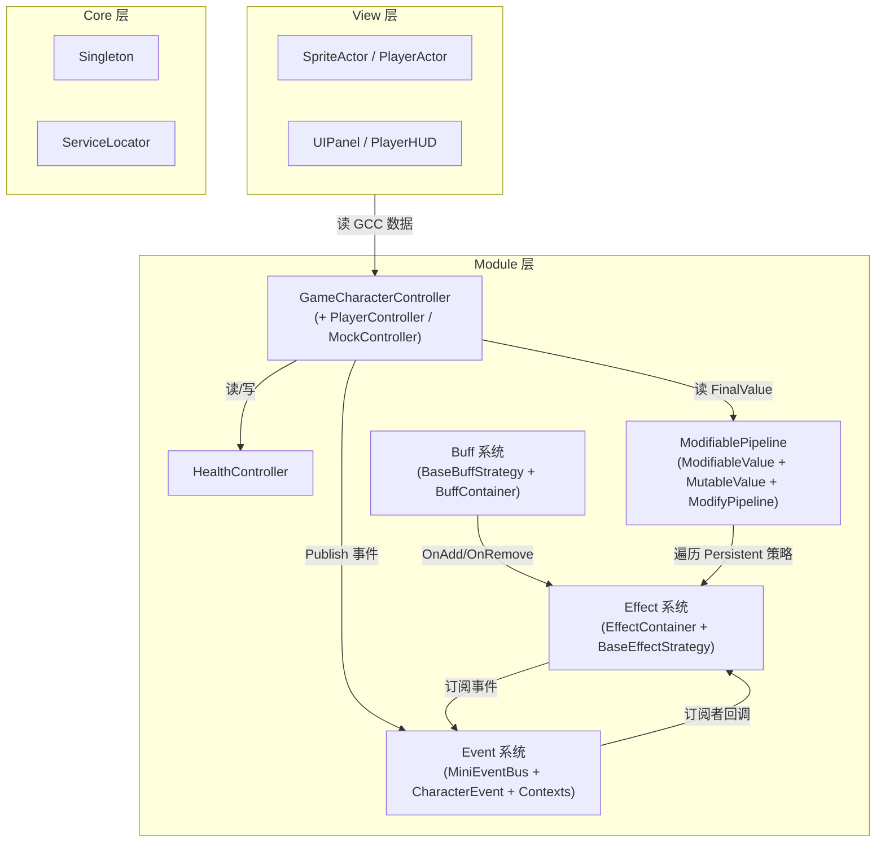

# Flicker — AI 开发指引

> 主策划案在 `Doc/主策划案.md`，手稿是设计初期 idea 不要看。
> 设计哲学在 `Doc/设计哲学.md`。
> **没我主动邀请，请不要改动我的代码，我自己会写。**

---

## 项目概述

Flicker 是一款单人肉鸽闯关 / 双人实时对抗游戏。玩家操控史莱姆在两面竖直墙壁间上下移动、跳跃踩踏对手。核心玩法围绕道具博弈（7Bag 随机、信息差）、Buff/效果系统和藏品构筑。

目前处于 **PvP 原型阶段**，暂不考虑 Mirror 网络同步。

---

## 架构分层



---

## 目录结构

```
Assets/Scripts/
├── Core/                      # 框架基础设施
│   ├── Singleton.cs           # 泛型单例
│   ├── MiniEventBus.cs        # 实例级事件总线
│   ├── EventBus.cs            # 静态全局总线（暂未用）
│   └── ServiceLocator/        # 服务定位器（振动管理）
│
├── Module/                    # 核心游戏逻辑
│   ├── Buff/                  # Buff 系统（策略定义 + 容器）
│   │   ├── BaseBuffStrategy.cs    # Buff 基类
│   │   ├── BuffContainer.cs       # Buff 计时器管理
│   │   └── BuffStrategies/        # 具体 Buff 实现
│   ├── CharacterController/   # 角色行为
│   │   ├── GameCharacterController.cs  # 实体行为基类
│   │   ├── PlayerController.cs         # 玩家输入驱动
│   │   └── MockController.cs          # 测试/AI
│   ├── Effect/                # 效果系统（策略定义 + 容器）
│   │   ├── BaseEffectStrategy.cs  # 效果策略基类
│   │   ├── EffectContainer.cs     # 效果列表管理
│   │   └── EffectStrategies/      # 具体效果实现
│   ├── Event/                 # 事件系统
│   │   ├── CharacterEvent.cs      # 14+ 个行为事件定义
│   │   └── ActionContext.cs       # 取消上下文 / 伤害上下文
│   ├── ModifiablePipeline/    # 修饰管线
│   │   ├── ModifiableValue.cs     # 可修饰属性（加区+乘区）
│   │   ├── MutableValue.cs        # 瞬时可变值（引用包装）
│   │   ├── ModifierSet.cs         # 数据集 DTO
│   │   └── ModifyPipeline.cs      # 管线结算入口
│   ├── HealthController.cs    # 生命值数据
│   ├── GameManager.cs         # 全局玩家引用
│   └── InputRouter.cs         # 输入路由
│
├── UI/                        # UI 框架
│   ├── UIManager.cs           # 面板堆栈管理
│   ├── UIPanel.cs             # 面板生命周期基类
│   ├── UILayer.cs             # 层级枚举
│   └── PlayerHUD.cs           # 玩家 HUD
│
└── View/                      # 视图层
    ├── SpriteActor.cs         # 精灵动画基类
    ├── PlayerActor.cs         # 玩家视图（动画监听）
    └── VibrationMgr.cs        # 振动服务
```

---

## 设计理念

### 快速失败原则

不为报错做软处理。传参越界、引用为空、类型不匹配——让它当场炸，不吞错、不静默降级。第一时间暴露、第一时间定位。

### 数据分类

| 类型                 | 实现                                                       | 适用                               |
| -------------------- | ---------------------------------------------------------- | ---------------------------------- |
| **可修饰属性** | `ModifiableValue`（baseValue + additives + multipliers） | moveSpeed, maxJumpingCD, damage 等 |
| **瞬时可变值** | `MutableValue`（引用类型包装的 float）                   | nowJumpingCD, currentHealth 等     |

`ModifiableValue.FinalValue` 由 `ModifyPipeline` 每帧结算：清空 → 遍历 Persistent 策略 → 输出最终值。值变化时触发观察者回调（等比缩放等）。

### 事件驱动

所有行为（Jump, Move, Attack, BeAttacked, Die...）都有 `BeforeXxx` 和 `AfterXxx` 事件对。Before 事件携带 `ActionContext`（可取消）或 `DamageContext`（可改伤害值），After 事件携带最终结果。

### UI 解耦

UI 完全不导入逻辑层命名空间。UI 通过 `GameManager` 拿 Player 引用，主动轮询读数。逻辑层不为 UI 发布任何展示事件。删除所有 UI 代码时逻辑完全正常。

### Mirror 预留

PvP 原型阶段不加 Mirror。肉鸽跑通后切分支，仅需改几处入口（`[Command]` 标记 + `[SyncVar]`）。整个 Buff/管线/事件系统全是本地计算，不受影响。

---

## 核心子系统速查

### 修饰管线

```
ModifyPipeline.GetModifierSet()
  → modifierSet.ClearModify()
  → 遍历 EffectContainer.GetEffectStrategies() → Apply(modifierSet)
  → NotifyAllObservers()（值变化时）
  → 返回 modifierSet
```

### Buff 系统

| 基类                 | 关键成员                                                                    |
| -------------------- | --------------------------------------------------------------------------- |
| `BaseBuffStrategy` | name, isStackable, stacks, maxStacks, OnAdd(), OnRemove(), OnStacksChange() |
| `BuffContainer`    | Update() tick → 到期 Remove。叠层：同类型 → stacks++ → 刷新 duration     |

### Effect 系统

| 基类                   | 关键成员                                                                                           |
| ---------------------- | -------------------------------------------------------------------------------------------------- |
| `BaseEffectStrategy` | gameObject, baseBuffStrategy, Apply(ModifierSet), Register(MiniEventBus), Unregister(MiniEventBus) |
| `EffectContainer`    | AddEffect/RemoveEffect，供 ModifyPipeline 和 Buff 调用                                             |

**两类 Effect**:

- **Persistent** — 走管线 `Apply()`，每次 `GetModifierSet()` 都参与结算
- **Triggered** — 订阅 MiniEventBus 事件，触发时直接操作（改 MutableValue / 取消 ActionContext）

### Event 定义

```
BeforeJump / AfterJump      BeforeParry / AfterParry
BeforeMove / AfterMove      BeforeStiff / AfterStiff
BeforeAttack / AfterAttack  BeforeBeAttacked / AfterBeAttacked
BeforeDie / AfterDie        UpdateEvent          StateChangedEvent
```

### 上下文

| 类                                | 作用                           |
| --------------------------------- | ------------------------------ |
| `ActionContext`                 | `bool cancelled` — 取消行为 |
| `DamageContext : ActionContext` | +`float damage` — 修改伤害  |

---

## 开发约定

- Effect 消耗次数/资源应订阅 **After 事件**（攻击确实发生后才扣），不浪费
- Before 事件修改 `damage` 或设 `cancelled`，不做消耗性操作
- `GameCharacterController` 所有 `state =` 必须走 `SetState()`，保证 `StateChangedEvent` 发布
- `towardUp` / `isRightWall` 必须先更新再调 `SetState()`
- 新增 Effect 策略时构造函数接收参数，基类不传配置
- Buff 通过 `OnAdd()` 创建 Effect 并加入 `EffectContainer`，`OnRemove()` 反向移除
