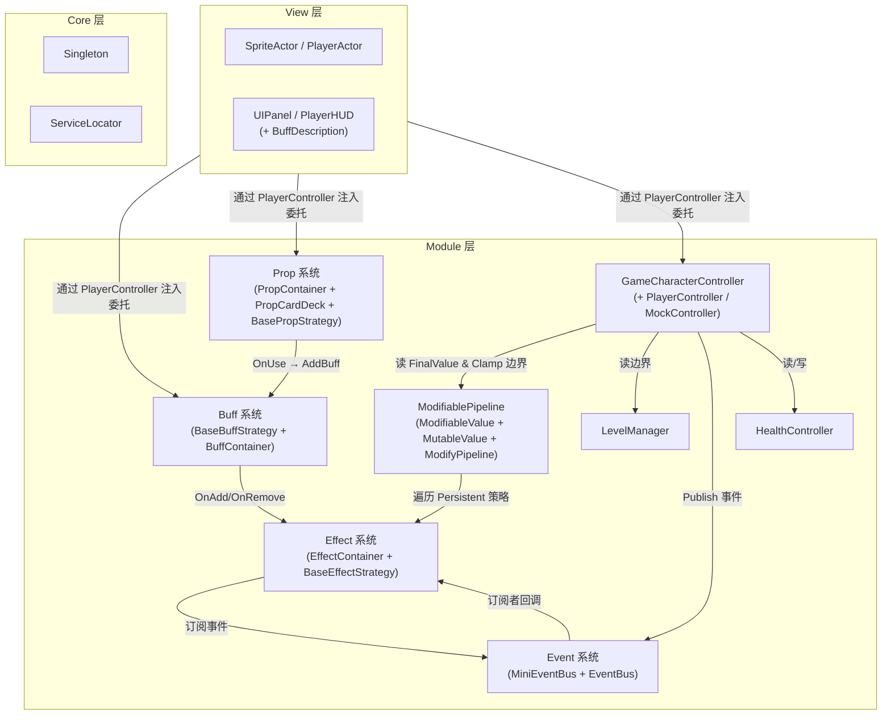

# Flicker — AI 开发指引

> 主策划案在 `Doc/主策划案.md`，手稿是设计初期 idea 不要看。
> 设计哲学在 `Doc/设计哲学.md`。
> 肉鸽子策划案在 `Doc/肉鸽地图系统策划案.md`。
> **没我主动邀请，请不要改动我的代码，我自己会写。**

---

## 项目概述

Flicker 是一款单人肉鸽闯关 / 双人实时对抗游戏。玩家操控史莱姆在两面竖直墙壁间上下移动、跳跃踩踏对手。核心玩法围绕道具博弈（7Bag 随机、信息差）、Buff/效果系统和藏品构筑。

目前处于 **PvP 原型阶段**，下一步接入 Mirror 做本地联机原型。

---

## 架构分层



---

## 目录结构

```
Assets/Scripts/
├── Core/                      # 框架基础设施
│   ├── Singleton.cs           # 泛型单例
│   ├── MiniEventBus.cs        # 实例级事件总线（角色行为事件）
│   ├── EventBus.cs            # 静态全局总线（UI 事件）
│   ├── Utils.cs               # 工具类（NonlinearDamper 等）
│   └── ServiceLocator/        # 服务定位器（振动管理）
│
├── Module/                    # 核心游戏逻辑
│   ├── Buff/                  # Buff 系统
│   │   ├── BaseBuffStrategy.cs    # Buff 基类（name, iconVisible, isStackable, stacks, maxStacks）
│   │   ├── BuffContainer.cs       # Buff 计时器管理 + UI 注入委托
│   │   └── BuffStrategies/        # 具体 Buff 实现
│   │       ├── AccelerateBuff.cs, ShieldBuff.cs, StiffnessBuff.cs
│   │       └── PropBuff/          # 道具卡专用 Buff
│   ├── CharacterController/   # 角色行为
│   │   ├── GameCharacterController.cs  # 实体行为基类（Move/Jump/Parry/边界检测）
│   │   ├── PlayerController.cs         # 玩家输入 + UI 事件注入
│   │   └── MockController.cs          # 测试/AI
│   ├── Effect/                # 效果系统
│   │   ├── BaseEffectStrategy.cs  # 效果策略基类（支持 delegate 字段：apply/onAdd/onRemove）
│   │   ├── EffectContainer.cs     # 效果列表管理
│   │   └── EffectStrategies/      # 具体效果实现
│   ├── Event/                 # 事件系统
│   │   ├── CharacterEvent.cs      # 角色行为事件 + Buff/Prop 事件
│   │   ├── ActionContext.cs       # 取消上下文 / 伤害上下文
│   │   ├── UIEvent.cs             # UI 层事件（道具/Buff 通知、描述框）
│   │   └── LevelEvent.cs          # 关卡事件（暂时未用）
│   ├── ModifiablePipeline/    # 修饰管线
│   │   ├── ModifiableValue.cs     # 可修饰属性（base + additives + multipliers）
│   │   ├── MutableValue.cs        # 瞬时可变值（引用包装的 float）
│   │   ├── ModifierSet.cs         # 数据集 DTO（moveSpeed, damage, propSlot 等）
│   │   └── ModifyPipeline.cs      # 管线结算入口
│   ├── PropCard/              # 道具卡系统
│   │   ├── BasePropStrategy.cs    # 道具基类（name, id, path, OnUse()）
│   │   ├── PropContainer.cs       # 道具槽管理 + CD 冷却 + UI 注入委托
│   │   ├── PropCardDeck.cs        # 7Bag 随机抽卡
│   │   ├── PropFactory.cs         # 道具注册工厂
│   │   └── PropStrategies/        # 具体道具实现
│   ├── HealthController.cs    # 生命值数据
│   ├── GameManager.cs         # 全局玩家引用
│   ├── LevelManager.cs        # 关卡管理器（边界数据/门状态/关卡生命周期）
│   └── InputRouter.cs         # 输入路由
│
├── UI/                        # UI 框架
│   ├── UIManager.cs           # 面板堆栈管理
│   ├── UIPanel.cs             # 面板生命周期基类
│   ├── UILayer.cs             # 层级枚举
│   ├── PlayerHUD.cs           # 玩家 HUD（跳跃CD/道具槽/buff图标栏/描述框）
│   └── BuffDescription.cs     # Buff 图标 hover 描述（IPointerEnter/Exit）
│
└── View/                      # 视图层
    ├── SpriteActor.cs         # 精灵动画基类
    ├── PlayerActor.cs         # 玩家视图（动画监听）
    └── VibrationMgr.cs        # 振动服务
```

---

## 设计理念

### 快速失败原则

不为报错做软处理。传参越界、引用为空、类型不匹配——让它当场炸，不吞错、不静默降级。第一时间暴露、第一时间定位。

### 数据分类

| 类型                 | 实现                                                       | 适用                               |
| -------------------- | ---------------------------------------------------------- | ---------------------------------- |
| **可修饰属性** | `ModifiableValue`（baseValue + additives + multipliers） | moveSpeed, maxJumpingCD, damage 等 |
| **瞬时可变值** | `MutableValue`（引用类型包装的 float）                   | nowJumpingCD, currentHealth 等     |

`ModifiableValue.FinalValue` 由 `ModifyPipeline` 每帧结算：清空 → 遍历 Persistent 策略 → 输出最终值。值变化时触发观察者回调（等比缩放等）。

### 事件驱动

所有行为（Jump, Move, Attack, BeAttacked, Die...）都有 `BeforeXxx` 和 `AfterXxx` 事件对。Before 事件携带 `ActionContext`（可取消）或 `DamageContext`（可改伤害值），After 事件携带最终结果。

### UI 解耦

逻辑层 **严禁直接调用 `EventBus.Publish`**。改为暴露 `Action` 委托字段，由 `PlayerController.Awake()` 统一注入 UI 发布逻辑：

```
BuffContainer.onBuffAdd      = (b) => EventBus.Publish(...)
BuffContainer.onBuffRemove   = (b) => EventBus.Publish(...)
PropContainer.onPropAdded    = (p,i) => EventBus.Publish(...)
PropContainer.onPropUse      = (i) => EventBus.Publish(...)
GCC.onUpdateJumpCDProgress   = (f) => EventBus.Publish(...)
```

**非本地玩家不注入** — Mirror 后加 `if (!isLocalPlayer) return;` 全部切断，零开销。

删除所有 UI 代码时逻辑完全正常。UI 层订阅 EventBus，不导入逻辑层命名空间。

### 关卡边界管理

`LevelManager`（Singleton）持有四个方向边界 + 门触发坐标：

- `leftTop` / `rightTop` / `leftBottom` / `rightBottom` — 战斗移动硬限制
- `doorJudge` — 门触发高度
- `GCC.Move()` 每帧读取边界做 `Mathf.Clamp`，在 Clamp 之前调用 `OnIntoEdge(LevelEdge)` 虚方法
- `PlayerController` 重写 `OnIntoEdge` → `LevelManager.Instance.OnPlayerIntoEdge()`，AI/MockController 不重写则碰壁无反应

边界是关卡属性，不走 `ModifierSet`。

### Mirror 预留

下一步接入 Mirror 做本地联机原型测试。委托注入 + `isLocalPlayer` 判断体系已就绪，整个 Buff/管线/事件系统全是本地计算，不受网络同步影响。

---

## 核心子系统速查

### 修饰管线

```
ModifyPipeline.GetModifierSet()
  → modifierSet.ClearModify()
  → 遍历 EffectContainer.GetEffectStrategies() → Apply(modifierSet)
  → NotifyAllObservers()（值变化时）
  → 返回 modifierSet
```

### Buff 系统

| 基类                 | 关键成员                                                                    |
| -------------------- | --------------------------------------------------------------------------- |
| `BaseBuffStrategy` | name, iconVisible, isStackable, stacks, maxStacks, OnAdd(), OnRemove(), OnStacksChange() |
| `BuffContainer`    | Update() tick → 到期 Remove。叠层：同类型 → stacks++ → 刷新 duration     |

`BuffContainer` 暴露 `onBuffAdd` / `onBuffRemove` / `onBuffStackChange` 委托字段（`Action<BaseBuffStrategy>`），供 PlayerController 注入 UI 发布。`AddBuff()` 内同时发布 MiniEventBus 事件（Before/After add stack remove），供 Effect 系统响应。

### Effect 系统

| 基类                   | 关键成员                                                                                           |
| ---------------------- | -------------------------------------------------------------------------------------------------- |
| `BaseEffectStrategy` | gameObject, baseBuffStrategy, `apply`/`onAdd`/`onRemove` 委托字段 + virtual 方法回退 |
| `EffectContainer`    | AddEffect/RemoveEffect，供 ModifyPipeline 和 Buff 调用                                             |

**两类 Effect**:

- **Persistent** — 走管线 `Apply()`，每次 `GetModifierSet()` 都参与结算
- **Triggered** — 订阅 MiniEventBus 事件，触发时直接操作（改 MutableValue / 取消 ActionContext）

**委托模式**：简单 Effect 用 lambda 内联创建，不写子类文件；复杂有状态 Effect（如 ShieldEffect 计数）保留独立类。

### Prop 系统

| 组件               | 职责                              |
| ------------------ | --------------------------------- |
| `BasePropStrategy` | 道具元数据（name, id, path, description）+ `OnUse()` 钩子 |
| `PropContainer`    | 道具槽管理、CD 冷却、`onPropAdded`/`onPropUse`/`onPropCD` 委托 |
| `PropCardDeck`     | 7Bag 随机抽卡                      |
| `PropFactory`      | 道具 id → 工厂委托 注册中心（Singleton） |

道具卡使用流程：`PropContainer.OnUse()` → `BasePropStrategy.OnUse()` → 创建 Buff → `BuffContainer.AddBuff()`。瞬发道具也可跳过 Buff，直接往 `EffectContainer` 加 Effect。

### 关卡管理器（LevelManager）

| 职责 | 说明 |
|------|------|
| 边界数据 | `leftTop`/`rightTop`/`leftBottom`/`rightBottom`，`doorJudge` 门触发高度 |
| 门状态 | 开门/关门，单扇/双扇门 |
| 关卡生命周期 | 战斗开始 → 敌怪全灭 → 门打开 → 光球出现 → 进门 |
| 敌怪计数 | 维护列表，全灭触发关卡完成 |

### Event 定义

**角色行为事件**（MiniEventBus，`CharacterEvent.cs`）：

```
BeforeJump / AfterJump      BeforeParry / AfterParry
BeforeMove / AfterMove      BeforeAttack / AfterAttack
BeforeBeAttacked / After    BeforeDie / AfterDie
UpdateEvent                  StateChangedEvent
```

**Buff 相关事件**（MiniEventBus）：

```
BeforeAddBuff / AfterAddBuff
BeforeBuffStack / AfterBuffStack
BeforeRemoveBuff / AfterRemoveBuff
```

**Prop 相关事件**（MiniEventBus）：

```
BeforeAddProp / AfterAddProp
BeforeUseProp / AfterUseProp
```

**UI 事件**（全局 `EventBus`，`UIEvent.cs`）：

```
GetPropEvent / GetPropNumberEvent / UsePropEvent
UpdateJumpCDProgressEvent / UpdatePropCDProgressEvent
AddNewBuffEvent / RemoveBuffEvent / BuffStackChangeEvent
ShowBuffDescriptionEvent / HideBuffDescriptionEvent
```

### 上下文

| 类                                | 作用                           |
| --------------------------------- | ------------------------------ |
| `ActionContext`                 | `bool cancelled` — 取消行为 |
| `DamageContext : ActionContext` | +`float damage` — 修改伤害  |

---

## 开发约定

- Effect 消耗次数/资源应订阅 **After 事件**（攻击确实发生后才扣），不浪费
- Before 事件修改 `damage` 或设 `cancelled`，不做消耗性操作
- `GameCharacterController` 所有 `state =` 必须走 `SetState()`，保证 `StateChangedEvent` 发布
- `towardUp` / `isRightWall` 必须先更新再调 `SetState()`
- 新增 Effect 策略时构造函数接收参数，基类不传配置
- Buff 通过 `OnAdd()` 创建 Effect 并加入 `EffectContainer`，`OnRemove()` 反向移除
- 逻辑层不直接调用 `EventBus.Publish`，改为暴露 `Action` 委托，由 `PlayerController.InjectUIEvent()` 统一注入；Mirror 后非本地玩家不注入，零开销切断 UI 事件流
- MiniEventBus 事件发布顺序：局部操作 → MiniEventBus(After) → UI 委托，从内到外
- 不可叠加 Buff 使用 `isStackable = true, maxStacks = 1` 实现，再次获得时刷新 duration 不叠层
