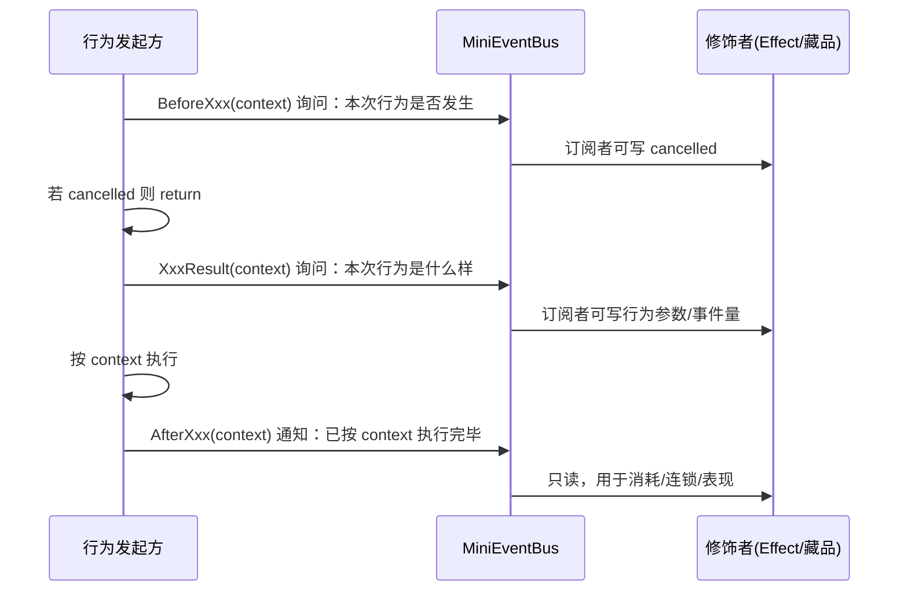
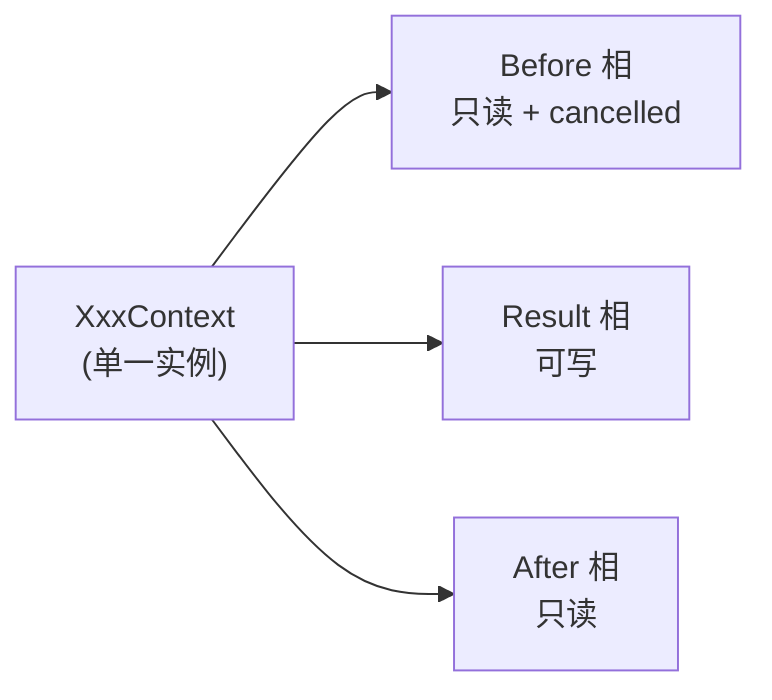
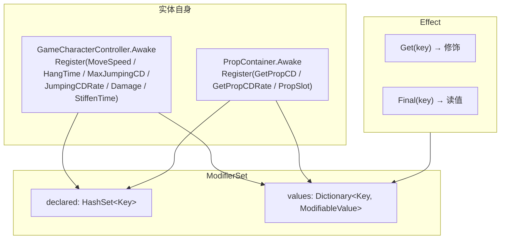
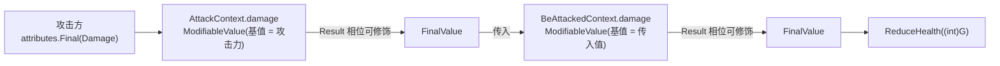
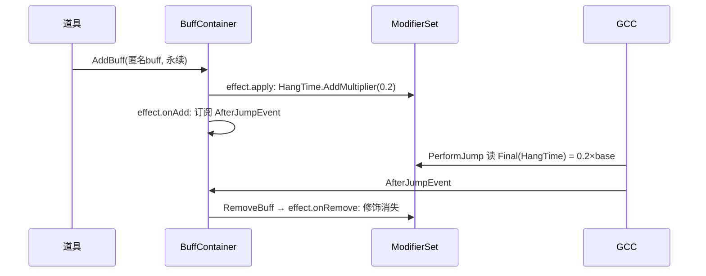

# Flicker 修饰系统重构规划

## 0. 文档目的

Flicker 目前的修饰系统只能表达"持续存在的属性变化"，无法表达"这一次行为产生的结果"。道具卡与藏品中大量"下一次跳跃滞空减少"、"本次伤害翻倍"、"弹反后不换向"这类效果因此无处落地，只能写成空壳。

本次重构引入**三相事件**与**行为上下文**，并把修饰集从具名字段改为键值对注册，同时删掉不再需要的固有变量与观察者机制。

重构期间必须保持原型可运行。已定的设计决策在本文档中记录为"定稿"，未决项统一列在文末。

---

## 1. 当前状态判断

### 1.1 相位缺失

角色行为目前只有两个相位：`BeforeXxx` 与 `AfterXxx`。以攻击为例：

```text
damage = GetModifierSet().damage.FinalValue   // 结果提前算好，与"这一次攻击"无关
damageContext.damage = damage
Publish BeforeAttackEvent                     // 既能取消，又能改数值
  ↓
victim.BeAttacked(gameObject, damageContext.damage)
Publish AfterAttackEvent                      // 空事件，不带任何结果
```

问题：

| 问题 | 表现 |
| --- | --- |
| Before 职责混合 | `DamageContext` 实际是"临时结果集"，却挂在 Before 上 |
| 结果不能按次修饰 | "下一次滞空减少 80%" 只能塞进持久修饰，用完还得摘除 |
| After 无结果 | 消耗计数、连锁、吸血类效果拿不到实际数值 |
| 结果与执行耦合 | 滞空时长、冷却、位移量内联在方法体里，没有可插入的修饰点 |

直接后果：`NodeviationArrowProp`、`ReverseFlowHourglassProp`、`EmergenceSporeProp` 三个道具的 `OnUse` 全是空的。

### 1.2 修饰集扩展成本

`ModifierSet` 有 12 个具名字段。新增一个属性需要同步改动 5 处：

1. `ModifierSet` 字段声明
2. `ModifierSet.ClearModify()` 手写一行
3. `ModifyPipeline` 初始化块
4. 实体 `Awake` 中的赋值
5. 所有读值点

### 1.3 固有变量与观察者

`ModifiableValue` 携带一套观察者机制（`observers` / `AddObserver` / `NotifyAllObservers`），全工程只有两处使用：

```text
GameCharacterController.Awake   nowJumpingCDMV  观察 maxJumpingCDMV
PropContainer.Awake             nowGetPropCDMV  观察 getPropCDMV
```

用途都是同一件事：属性上限变化时，把"剩余时间"按比例缩放，以维持 `剩余 / 上限` 不变。

观察者维护的那个量本身就是 `剩余 / 上限`。因此不需要回调，**直接存比例即可消解整套机制**：

| 事件 | 存绝对剩余时间 $T$（现状） | 存比例 $r = T / M$ |
| --- | --- | --- |
| 每帧 | $T \mathrel{-}= \Delta t \cdot \text{rate}$ | $r \mathrel{-}= \Delta t \cdot \text{rate} / M$ |
| 上限 $M$ 变化 | $T \mathrel{*}= M_{新}/M_{旧}$（观察者） | $r$ 不变 |
| UI 进度 | $T / M$ | $r$ |
| 进入满冷却 | $T = M$ | $r = 1$ |

### 1.4 现存缺陷清单

| 位置 | 问题 |
| --- | --- |
| `ModifierSet.nowStiffTime` | 声明后从未初始化，死字段 |
| `ModifyPipeline.propContainer` | 赋值后从未使用，死字段 |
| `ModifyPipeline.Start()` | 空方法 |
| `GameCharacterController` L125 | 注释掉的 `nowStiffTimeMV` 残留 |
| `JumpingCoroutine` | 跨帧持有共享的 `ModifierSet` 实例，中途又重新获取 |
| `AttackDetect` | 循环内每个目标都调一次 `GetModifierSet()`，多目标时重复全量重算 |
| `EffectContainer.GetEffectStrategies()` | 每次调用都新建 `List` 拷贝，每帧产生 GC |
| `AccelerateEffect.Apply` | 参数名 `ModifierSet` 与类型名同名，遮蔽类型名 |
| `ShieldEffect` | 用 Before 的 `cancelled` 实现免疫，导致受击整个不发生，`AfterBeAttackedEvent` 不发布 |
| `AfterJumpEvent` | 由 `isForce` 门控，业务字段兼职事件开关 |

---

## 2. 目标模型

### 2.1 三相事件

每个角色行为拆为三个相位：



| 相位 | 语义 | 可否取消 | 主要用途 |
| --- | --- | --- | --- |
| **Before** | 决定本次行为是否发生 | 可以（写 `cancelled`） | 条件门控、属性门槛、禁止类效果 |
| **Result** | 决定本次行为产生什么 | 不可以 | 一次性修饰、方向翻转、伤害调整 |
| **After** | 本次行为已发生 | 不可以 | 消耗次数、连锁触发、表现广播 |

**取消只属于 Before。** 取消的语义是"本次行为不发生"——直接 `return`，后续两个相位都不发布。

### 2.2 行为上下文

**取代原"结果集"概念。** 每个行为一个上下文类，在 Before 相位之前构造，**三个相位共用同一个实例**。



- 行为参数与事件量装在一起，不存在"输入/输出两套数据要同步"的问题
- 属性通过基类的 `attributes` 字段随上下文携带，订阅者不需要 `GetComponent<ModifyPipeline>()`

### 2.3 修饰集

修饰集只保留**实体固有属性**，改为枚举 + 字典：

```text
ModifierSet
├── enum Key          修饰键
├── Dictionary<Key, ModifiableValue>   槽位（含惰性补足）
├── HashSet<Key>       declared         实体显式注册过的键
└── Register / Get / Final / Has / ClearModify
```



**修饰集与结果集的差别（也是不合并的理由）：**

| | 修饰集 | 行为上下文 |
| --- | --- | --- |
| 语义 | 实体固有属性 | 本次行为的参数与事件量 |
| 生命周期 | 与实体同生共死 | 单次行为，用完即弃 |
| 谁写 | 持久型 Effect 的 `apply` | Result 相位的订阅者 |
| 扩展频率 | 高（随系统拓展） | 低（行为基本固定） |
| 结构 | 枚举 + 字典 | 具名字段 |
| 值类型 | `ModifiableValue` | `ModifiableValue` + `bool` + `GameObject` |

字典是为"未知的将来"付的钱。修饰集面对未知（会一直长），上下文面对已知（攻击无非伤害/暴击），**所以两者结构不同是对的**。

**统一点在值类型**：两处都用 `ModifiableValue` 承载数值，操作词表完全一致（`AddAdditive` / `AddMultiplier` / `FinalValue`）。

### 2.4 固有属性与随事件产生的量

这是本次重构最重要的分界线。

| | 固有属性 | 随事件产生的量 |
| --- | --- | --- |
| 定义 | 实体长期拥有，每帧被重算 | 由本次行为算出，用完即弃 |
| 例子 | `MoveSpeed`、`HangTime`、`MaxJumpingCD`、`Damage`、`PropSlot` | 本次伤害值 |
| 存放 | `ModifierSet` | 行为上下文 |
| 读取方式 | `context.attributes.Final(Key.X)` | `context.damage.FinalValue` |

判定规则：

- **"接下来会发生什么"用固有属性表达** —— 滞空时长、移动速度、冷却时长都是 `HangTime` / `MoveSpeed` / `MaxJumpingCD` 的现值，**不复制进上下文**。
- **"这一次产生了什么"用上下文表达** —— 伤害是攻击力算出的单次值，且受击方的伤害来自攻击方传入，不属于防御方的属性，**必须进上下文**。



**两端各自新建 `ModifiableValue`**：攻击方的加区/乘区已在 `FinalValue` 结算完毕，防御方从干净基数开始修饰，两边不互相污染。

### 2.5 修饰的两种载体

| 效果类型 | 载体 | 例子 |
| --- | --- | --- |
| 持续性修饰 | 持久型 Effect 的 `apply`，写入 `ModifierSet` | 移速 +150%、僵直减速 50% |
| 一次性修饰（改数值） | 匿名 Buff + 持久修饰 + After 自摘 | 下一次跳跃滞空 -80%、下一次冷却 -50% |
| 一次性修饰（改参数） | Result 相位写上下文 | 反跳、不偏矢、护盾归零 |

**"下一次……"类效果统一用匿名 Buff 实现**，而不是在上下文里放一份属性副本。

以羽化孢子（下一次跳跃滞空 -80%）为例：

```text
获得孢子     → HangTime × 0.2 挂上（持久修饰）
第一次跳跃   → PerformJump 读 attributes.Final(HangTime) = 0.2 × base  ✓
跳跃结束     → AfterJumpEvent → 自摘 buff → 修饰消失
第二次跳跃   → base  ✓
```



**消费必须在 After 相位，不能在 Result 相位。** 跳跃协程是在 Result 相位之后才读 `hangTime` 的；若在 Result 就摘掉修饰，协程读到的会是裸值。

---

## 3. 设计约定

### 3.1 相位权限

| 相位 | `attributes` | 上下文的数值字段 | 上下文的参数 | `cancelled` |
| --- | :---: | :---: | :---: | :---: |
| Before | 只读 | 只读 | 只读 | **可写** |
| Result | 只读 | **可写** | **可写** | 未定义 |
| After | 只读 | 只读 | 只读 | 只读 |

这条是**人为约定**，不做编译期强制。在 Result 相位写 `cancelled` 不会报错，但无人读取（取消判定已在 Before 之后完成）。

### 3.2 上下文字段规则

上下文的字段只允许两类：

| 类别 | 类型 | 例子 |
| --- | --- | --- |
| ① 行为参数 | `bool` / `GameObject` / `int` | `toRightWall`、`victim`、`slotIndex` |
| ② 随事件产生的量 | `ModifiableValue` | `damage` |

**固有属性一律不复制为字段**，一律经 `context.attributes.Final(Key.X)` 读取。

### 3.3 注册时机

**约定：`Awake` 只注册，不读取。**

Unity 不保证同一 `GameObject` 上组件的 `Awake` 顺序，`GCC.Awake` 与 `PropContainer.Awake` 谁先执行不确定，因此：

- 可在 `Awake` 中调用 `Register(...)`
- 不可在 `Awake` 中调用 `Final(...)` 或 `GetModifierSet()`

所有行为发生在 `Update` 与行为方法中，晚于全部 `Awake`，因此安全。

### 3.4 读写宽容

由于访问已收归函数，`ModifierSet` 的缺失键处理为**惰性补足**，读写一致：

```text
Get(key) / Final(key)  →  键不存在 → 创建 ModifiableValue(0f) 并登记 → 永不抛异常
```

| 场景 | 结果 |
| --- | --- |
| 小怪没有 `PropContainer`，藏品给 `PropSlot` 加 1 | 补槽 base 0 → 加 1 → 无人读 → **无效，不报错** |
| 小怪读 `Final(PropSlot)` | 补槽 → 返回 **0**，语义为"没有道具槽"，正确 |
| 小怪读 `Final(GetPropCD)` | 返回 **0**，语义为"无冷却"，正确 |

**占位槽的性质**：最多 9 个（等于枚举成员数）；`ClearModify` 每帧清空加区/乘区，不跨帧累积；不删除（避免"每次写都重建"的抖动）。

**关于"该注册却没注册"**：不做专门的校验。惰性补值已把"没注册 = 默认值 0"这个语义表达完整，再叠一层校验属于多余——实体自己的读取点就是最直接的反馈（读到 0 没生效）。

### 3.5 判定顺序

**各相位只在"自己的时刻"读取属性值，判定一旦做出不再复核。**

```text
Before  读 attributes.Final(MoveSpeed) = 10.0    ← 判定用的就是这个数
Result  写 context 的字段（不回写 attribute）
After   读 context                                  ← 看到的是 Result 后的值
```

- **属性不回写**：Result 相位的修改只作用于上下文自身字段。`GetModifierSet()` 每次调用都会 `ClearModify()` 重算，写入修饰集的内容下一次会被清掉，所以"Result 改属性导致 Before 判定变化"在架构上不可能发生。
- **不隐式重试**：要实现"改了之后重新判定"，必须显式再发一次 Before 事件。
- **相位内顺序相关性**取决于写什么：

| 写什么 | 顺序相关 | 原因 |
| --- | :---: | --- |
| `AddAdditive` / `AddMultiplier` | 否 | 加区/乘区分桶聚合，与注册顺序无关 |
| `bool` 直接赋值 | 是 | 赋值语义 |

数值部分**顺序无关**是把 `ModifiableValue` 用作上下文数值类型的直接收益。

### 3.7 一次性 Effect 的消费

**由 Effect 自己移除**（`effectContainer.RemoveEffect(this)`）。

需要注意 `EffectContainer.RemoveEffect` 支持迭代中移除（打标记 + 遍历结束后清扫），否则持久型 Effect 在 `apply` 期间间接触发移除会改到正在遍历的列表。

`MiniEventBus.Publish` 在调用前已捕获委托列表，回调中 `Unsubscribe` 自身是安全的。

---

## 4. 核心类型

### 4.1 `Core/Utils.cs` — `Ratio`

与 `NonlinearDamper` 同文件同命名空间。把"上限为 0"的除零守卫集中到一处。

```csharp
public static class Ratio
{
    public const float Empty = 0f;   // 无剩余（就绪）
    public const float Full  = 1f;   // 剩余拉满（刚使用）

    /// <summary>已知上限，求比例</summary>
    public static float ToRatio(float value, float max)
        => max > 0f ? Mathf.Clamp01(value / max) : Empty;

    /// <summary>已知上限与比例，求实际值</summary>
    public static float ToValue(float ratio, float max)
        => max > 0f ? ratio * max : 0f;

    /// <summary>已知上限与比例，按增量推进；delta 以"值"为单位</summary>
    public static float Advance(float ratio, float max, float delta)
        => max > 0f ? Mathf.Clamp01(ratio + delta / max) : Empty;
}
```

`max <= 0` 按"无冷却 = 立刻就绪"处理，返回 `Empty`。

### 4.2 `ModifiableValue` — 退化为纯公式

```text
base + Σ additives  →  × Π multipliers  →  FinalValue
```

删除全部观察者机制：`observers`、`AddObserver`、`RemoveObserver`、`NotifyAllObservers`、`_lastFinalValue`。`FinalValue` 不再做变化检测（无人关心"值变了"）。

保留 `BaseValue`、`AddAdditive`、`AddMultiplier`、`ClearModify`。

### 4.3 `ModifierSet`

```csharp
public class ModifierSet
{
    public enum Key
    {
        MoveSpeed, HangTime, MaxJumpingCD, JumpingCDRate,
        Damage, PropSlot, GetPropCD, GetPropCDRate, StiffenTime,
    }

    readonly Dictionary<Key, ModifiableValue> values = new();
    readonly HashSet<Key> declared = new();

    /// <summary>注册固有属性，仅由实体自身在 Awake 中调用</summary>
    public void Register(Key key, ModifiableValue value);   // 重复注册抛异常

    /// <summary>取得可修饰值，缺失时惰性补足基值 0 的槽位</summary>
    public ModifiableValue Get(Key key);

    /// <summary>直接读最终值，与 Get 同一路径</summary>
    public float Final(Key key) => Get(key).FinalValue;

    /// <summary>实体是否显式注册过该属性</summary>
    public bool Has(Key key) => declared.Contains(key);

    public void ClearModify();                              // 遍历 values.Values
}
```

### 4.4 行为上下文家族

全部放在 `Event/ActionContext.cs` 一个文件（行为只有跳跃/弹反/攻击/移动/使用道具，未来最多再加 1~2 个）。

```csharp
namespace Flicker.Module.Context
{
    /// <summary>
    /// 行为上下文基类。三相共用同一实例：
    /// Before 只读 + 写 cancelled ／ Result 写事件量 ／ After 全只读
    ///
    /// 字段规则：只放「行为参数」与「随事件产生的量」。
    /// 固有属性一律经 attributes 读，不复制成字段。
    /// </summary>
    public class ActionContext
    {
        public ModifierSet attributes;
        public bool cancelled;
    }

    public class JumpContext : ActionContext
    {
        public bool toRightWall;
        public bool ignoreCD;
    }

    public class MoveContext : ActionContext
    {
        public bool isUp;
    }

    public class ParryContext : ActionContext
    {
        public GameObject opponent;
        public bool reverse;
    }

    public class AttackContext : ActionContext
    {
        public GameObject victim;
        public ModifiableValue damage;
    }

    public class BeAttackedContext : ActionContext
    {
        public GameObject attacker;
        public ModifiableValue damage;
    }

    public class UsePropContext : ActionContext
    {
        public BasePropStrategy prop;
        public int slotIndex;
    }
}
```

`DamageContext` 删除，其角色由 `AttackContext.damage` / `BeAttackedContext.damage` 取代，并从裸 `float` 升级为 `ModifiableValue`。

### 4.5 事件三兄弟

每个行为三个事件，**都只带同一个上下文引用**：

```csharp
public struct BeforeJumpEvent { public JumpContext context; }
public struct JumpResultEvent  { public JumpContext context; }
public struct AfterJumpEvent   { public JumpContext context; }
```

受影响的行为共 11 组：Jump / Parry / Attack / BeAttacked / Move / Die / AddBuff / BuffStack / RemoveBuff / AddProp / UseProp。

---

## 5. 行为链改造

### 5.1 跳跃（完整示例）

#### 入口

```csharp
/// <summary>跳跃。受状态与跳跃CD限制</summary>
public void Jump() => PerformJump(ignoreCD: false);

/// <summary>强制跳跃。不受跳跃CD限制，但仍要求处于可跳状态</summary>
public void ForceJump() => PerformJump(ignoreCD: true);

private void PerformJump(bool ignoreCD)
{
    if (IsLogicDisabled) return;
    if (state != GameCharacterState.Idle && state != GameCharacterState.Moving) return;
    if (!ignoreCD && jumpCDRatio > 0) return;

    ModifierSet attributes = modifyPipeline.GetModifierSet();
    JumpContext context = new()
    {
        attributes  = attributes,
        toRightWall = !isRightWall,
        ignoreCD    = ignoreCD,
    };

    miniEventBus.Publish<BeforeJumpEvent>(new(){ context = context });
    if (context.cancelled) return;

    miniEventBus.Publish<JumpResultEvent>(new(){ context = context });

    /** 当前状态闸门保证不会在跳跃进行中重入，此分支实际不可达。
     *  保留以备后续二段跳等"可空中起跳"的改动 */
    if (_jumpingCoroutine != null) StopCoroutine(_jumpingCoroutine);
    _jumpingCoroutine = StartCoroutine(JumpingCoroutine(context));
}
```

**闸门顺序**：逻辑暂停 → 状态（Idle / Moving，两个入口共用）→ CD（`ignoreCD` 时跳过）。

`isForce` 更名为 `ignoreCD`：语义统一为"不会被跳跃CD限制的跳跃"，且不再兼职 After 事件开关。

#### 协程

只消费上下文，不重新决策：

```text
float hangTime = context.attributes.Final(ModifierSet.Key.HangTime);
distination.x  = context.toRightWall ? rightWallPos : leftWallPos;
...
jumpCDRatio = Ratio.Full;                      // 在 After 发布之前，允许订阅者改
miniEventBus.Publish<AfterJumpEvent>(...);     // 无条件发布
isRightWall = context.toRightWall;
```

| 项 | 旧 | 新 |
| --- | --- | --- |
| 事件 | 2 个（After 为空） | 3 个，都带 `JumpContext` |
| Before 可见 | 仅 `toRightWall` | `attributes` + `toRightWall` + `ignoreCD` |
| CD 存储 | `MutableValue nowJumpingCDMV` | `float jumpCDRatio` |
| CD 观察者 | `maxJumpingCDMV.AddObserver(...)` | 无 |
| UI 进度 | `value / maxJumpingCDMV.FinalValue` | `jumpCDRatio` |
| After 门控 | `if (!isForce)` | 无条件 |
| 方向来源 | 内联 `!isRightWall` | `context.toRightWall` |

#### 消费方

**跳跃禁止（Before 取消）**

```csharp
private void Callback(BeforeJumpEvent e) => e.context.cancelled = true;
```

**属性条件取消（Before 读属性）**

```csharp
private void Callback(BeforeJumpEvent e)
{
    if (e.context.attributes.Final(ModifierSet.Key.MoveSpeed) < 2f)
        e.context.cancelled = true;
}
```

**羽化孢子（匿名 Buff + 持久修饰 + After 自摘）**

```csharp
BaseBuffStrategy buff = new()
{
    name = "羽化孢子",
    description = "下一次跳跃的滞空时间减少80%",
    iconVisible = false,
};

Action<AfterJumpEvent> onJumped = null;
BaseEffectStrategy effect = new();
effect.apply    = (e, m) => m.Get(ModifierSet.Key.HangTime).AddMultiplier(0.2f);
effect.onAdd    = (e) => e.miniEventBus.Subscribe<AfterJumpEvent>(onJumped);
effect.onRemove = (e) => e.miniEventBus.Unsubscribe<AfterJumpEvent>(onJumped);
onJumped        = (evt) => buffContainer.RemoveBuff(buff);

buff.onAdd    = (b) => effectContainer.AddEffect(effect, b);
buff.onRemove = (b) => effectContainer.RemoveEffect(effect);

buffContainer.AddBuff(buff, -1f);
```

链式移除是安全的：`AfterJump → RemoveBuff → buff.onRemove → RemoveEffect → effect.onRemove → Unsubscribe`。

### 5.2 其余行为

#### 移动

每帧执行，`MoveContext` 只有 `isUp`。移速走 `attributes.Final(MoveSpeed)`。

注意：现有代码在 Before 之后才调 `GetModifierSet()`（取消时提前 `return`）。改造后为让 Before 能读属性，`GetModifierSet()` 必须提到 Before 之前，**即使被取消也会算一次修饰集**。

#### 弹反

```csharp
public class ParryContext : ActionContext
{
    public GameObject opponent;
    public bool reverse;      // 不偏矢改写这里
}
```

弹反的执行**发生在跳跃协程内部**（`ParryDetect` → `parryAtFrame` → 协程交换起点终点）。跳跃协程需要读取 `ParryContext.reverse` 来决定是否换向，因此弹反链要解决"上下文在协程之间交错"的问题。

#### 攻击 / 受击

两个上下文各持一个 `damage`，基值来源不同（见 2.4）。`BeAttacked` 签名从 `(GameObject, int)` 放宽为 `(GameObject, float)`，整数化挪到 `ReduceHealth`。

护盾的迁移：

| | 现状 | 改后 |
| --- | --- | --- |
| 拦截 | `BeforeBeAttacked` 写 `cancelled` | `BeAttackedResult` 写 `damage.AddMultiplier(0f)` |
| 后果 | 受击整个不发生，`AfterBeAttacked` 不发布 | 受击发生，扣血 0 |
| 计数消耗 | 在 Before 中扣（因为 After 收不到） | 在 After 中扣（语义正确） |

---

## 6. 分阶段实施

### 阶段一：修饰集键值对化 + 删除观察者

**目标**：纯机械重构，行为零变化。

工作内容：

1. `Core/Utils.cs` 新增 `Ratio` 静态类
2. `ModifiableValue` 删除观察者机制，退化为纯公式
3. `ModifierSet` 改为枚举 + 字典，实现 `Register` / `Get` / `Final` / `Has` / `ClearModify`
4. `ModifyPipeline` 删除初始化块与死字段 `propContainer`
5. `GameCharacterController` 注册 6 个键，`nowJumpingCDMV` 改为 `jumpCDRatio`
6. `PropContainer` 注册 3 个键，`nowGetPropCDMV` 改为 `propCDRatio`
7. 删除 `MutableValue.cs`
8. 全部读值点改 `Final(Key.X)`
9. `AccelerateEffect` / `RushGelBuff` 改 `Get(Key.X).AddMultiplier(...)`
10. `EffectContainer.GetEffectStrategies()` 去掉每次 `new List` 拷贝
11. 清理死代码（`nowStiffTime`、`propContainer`、空 `Start`、注释残留）

**必须注意的坑**

| # | 位置 | 问题 |
| --- | --- | --- |
| 1 | `AccelerateEffect.Apply(ModifierSet ModifierSet)` | 参数名遮蔽类型名，加上嵌套枚举后无法 `ModifierSet.Key`，必须改名为 `modifierSet` |
| 2 | `PropContainer.Update` 的 CD 归零判定 | 原本是"先减再判 `< 0`"；`Ratio.Advance` 会夹到 0，**必须改成 `<= 0`**，否则道具永远发不出来且不报错 |
| 3 | `Ratio.Advance` 的 `Clamp01` | 引入了原本没有的上界。冷却语义下 `delta` 恒为负，不会触发，行为等价 |

**验收标准**

- 全工程编译通过
- 移动 / 跳跃 / 攻击 / 受击 / 道具 / Buff 全链路与改前一致
- CD 结束后能正常发放道具（重点验坑 2）
- 全工程搜 `MutableValue` / `AddObserver` / `onUpdate` 零命中
- 修改 `MaxJumpingCD` 修饰时，UI 进度**不跳变**（验证"观察者被消解"的等价性）

### 阶段二：三相骨架 + 打通攻击 / 受击

**目标**：验证三相模型与上下文携带属性。

工作内容：

1. `ActionContext` 瘦身为基类（`attributes` + `cancelled`），新增 `AttackContext` / `BeAttackedContext`，删除 `DamageContext`
2. 新增 `BeforeAttackEvent` / `AttackResultEvent` / `AfterAttackEvent` 与受击侧对应三个
3. `AttackDetect` 三段化，循环内的 `GetModifierSet()` 提到循环外
4. `BeAttacked` 三段化，签名放宽为 `float`
5. `ShieldEffect` 迁移到 Result 相位归零 + After 相位扣次数
6. `EffectContainer.AddEffect` 绑定 `effectContainer` 到 Effect；`BaseEffectStrategy` 增加结果事件订阅助手

**验收标准**

- 护盾能吸收伤害，且受击事件正常发布
- After 相位能读到实际伤害值
- `DamageContext` 全工程零残留
- 攻击多目标时只算一次修饰集

### 阶段三：铺开剩余行为

**目标**：跳跃 / 移动 / 弹反 / 道具 / Buff 全部三相化。

工作内容：

1. 跳跃：`PerformJump` 三段化，`isForce` → `ignoreCD`，`jumpCDRatio` 替代绝对时间，After 无条件发布
2. 移动：`MoveContext`，`GetModifierSet()` 提前
3. 弹反：`ParryContext`，解决与跳跃协程的上下文交错
4. 道具：`AddProp` / `UseProp` 三段化
5. Buff：`AddBuff` / `BuffStack` / `RemoveBuff` 三段化
6. `BaseBuffStrategy` 增加 `onAdd` / `onRemove` 委托字段（支持匿名 Buff）
7. 放开 `buffContainer` / `effectContainer` 的访问权限

**验收标准**

- 羽化孢子、逆流沙壶、不偏矢三个道具可用
- 强制跳跃不打断进行中的跳跃，且照常进入冷却
- 僵直期间不能跳跃且减速 50%

### 阶段四：收尾

实际实施：

1. **空壳道具实现**：`EmergenceSporeProp` / `ReverseFlowHourglassProp` / `NodeviationArrowProp` 三件已完成，均采用「匿名 Buff + 持久修饰或订阅 + 自搞」模式
2. **道具绑定使用者**：`BasePropStrategy` 新增 `user` 字段与 `BindUser()`，由 `PropContainer.AddProp` 在道具入槽时绑定
3. **匿名 Buff 支持**：`BaseBuffStrategy` 新增 `onAdd` / `onRemove` 委托字段（与 virtual 钩子二选一）

未做：

- `NodeviationArrowBuff` 骨架被匿名 Buff 取代后成为死代码，待确认是否删除
- `HealthController` 增加按上下文结算的入口（当前 `ReduceHealth((int)...)` 已足够）
- `AGENTS.md` / `设计哲学.md` 的文档同步

---

## 7. 风险与检查清单

| 风险 | 说明 |
| --- | --- |
| 共享 `ModifierSet` 实例 | `GetModifierSet()` 返回同一对象，下次调用即 `ClearModify` 重算。Before 相位只读，不可写入 |
| 协程跨帧 | `JumpingCoroutine` 持有 `JumpContext` 跨帧，但其中读属性时**必须重新获取修饰集**（僵直等效果可能在滞空期间生效） |
| AI / 傀儡 | `MockController` 复用同一套行为，上下文构造不要假设只有玩家 |
| 属性被压到 0 | `hangTime` 可被多次修饰。协程内 `timer / hangTime` 应改用 `Ratio.ToRatio(timer, hangTime)`，避免 NaN 污染坐标 |
| 打断的跳跃 | 状态闸门保证不会再发生；`_jumpingCoroutine` 的 `StopCoroutine` 分支当前不可达，保留以备二段跳 |
| 破坏面 | 阶段一会让全工程编译报错（字段名全改），建议在独立分支进行 |

---

## 8. 参考设计

| 系统 | 对应我们的 | 结论 |
| --- | --- | --- |
| Unreal GAS — `Instant` vs `Infinite` GameplayEffect | 一次性修饰 vs 持久修饰 | 方向正确 |
| Unreal GAS — `SetByCaller` | 行为上下文 | 业界标准的"按次传入临时量"机制 |
| Unreal GAS — op 分桶（Add → Multiply → Override） | `additives` / `multipliers` | 一致；已有实现，补文档说明 |
| Unreal GAS — `GameplayTag` 门控 | `Before` + `cancelled` | 一致 |
| Path of Exile — increased（加法桶）vs more（乘法桶） | `AddAdditive` vs `AddMultiplier` | 桶内相加、桶间相乘，与注册顺序无关 |
| RimWorld — `StatDef` + `StatModifierPriority` | 枚举键 + 两个独立方法 | 业界显式编码优先级；我们用 API 名区分 |
| 杀戮尖塔 — `atDamageGive` / `atDamageReceive` | **Result 相位** | 行业对"数值形成中"的标准分层 |
| 杀戮尖塔 — Power 自减 `amount--` | Effect 自管移除 | 常见做法 |

**不采用**：RimWorld / GAS 的反射式属性键（`StatDef` / `FGameplayAttribute`）。那是为 Mod 支持与编辑器配置付出的性能与复杂度代价。本项目体量与"快速失败"哲学下，枚举键是正确选择。

**枚举键的用途仅为防止拼写错误**，不做运行期白名单校验——信任开发者。

---

## 9. 实施状态

四个阶段均已落地，`Assembly-CSharp` 编译通过（0 错误 0 警告）。

| 阶段 | 提交 | 内容 |
| --- | --- | --- |
| 一 | `47c1f1e` | 修饰集键值对化，移除 `MutableValue` 与观察者 |
| 二 | `ddce9e9` | 攻击/受击三相化，引入行为上下文 |
| 三 | `9ecfde8` | 跳跃/移动/弹反/死亡/buff/道具全量三相化 |
| 四 | 待提交 | 空壳道具实现、道具绑定使用者、注册校验 |

### 与初版设计的偏差

| # | 偏差 | 说明 |
| --- | --- | --- |
| 1 | `RemoveBuff` 只有两个相位 | 移除 buff 没有可修饰的量（`duration` 已作废），不设 `RemoveBuffResultEvent` |
| 2 | Buff 上下文不含 `stacks` | `stacks` 在流程中会变化，不是可修饰数据；需要时经 `context.buff.stacks` 读取 |
| 3 | `AddPropContext` 不含 `slotIndex` | 槽位是执行时扫描的结果，不是行为参数 |
| 4 | 弹反反向开关位于 `JumpContext.reverse` | 弹反的结果体现为对发起方跳跃上下文的修改，`ParryContext` 持有 `jump` 引用 |
| 5 | 冷却缩减不靠 `MaxJumpingCD` | 比例模型下，`jumpCDRatio *= 0.5f` 即等价于剩余冷却时间减半 |

### 仍需运行时验证

编译通过不等于行为正确，以下需在编辑器中实际验证：

- 蓽化孢子：使用后下一次跳跃滞空时间确实减半（且只影响一次）
- 逆流沙漏：立即重置冷却，且下一次跳跃冷却减半
- 不偏矢：下一次弹反后继续原方向，弹反后仅消耗一层
- 疾行凝胶 / 僵直 / 护盾 与改前一致
- 移动与跳跃手感未因修饰集提前结算而变化
