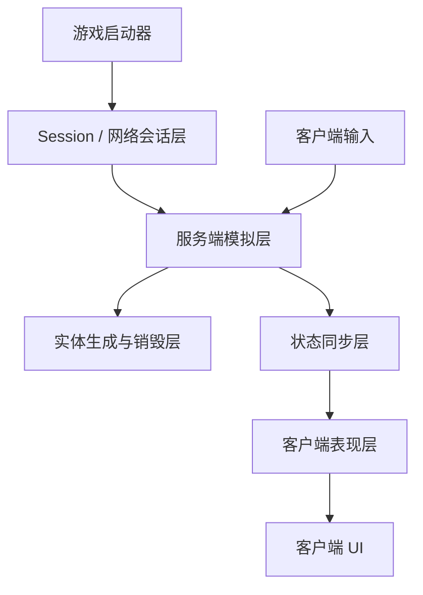

# Flicker 联机优先重构规划

## 0. 文档目的

Flicker 目前是“单机逻辑为主，多人模式补充”的结构。随着投掷物、地块机关、动态敌怪和道具效果加入，这种结构会让每个系统同时维护单机生命周期和网络生命周期，造成创建、更新、销毁、表现同步彼此耦合。

本次重构的目标不是把所有代码都改成 `NetworkBehaviour`，而是统一游戏运行时的权威逻辑入口：

> 单人模式使用本地 Host，多人模式使用同一套服务端模拟逻辑；客户端只负责输入、表现和本地反馈。

重构期间必须保持原型可运行，每个阶段都应留下可以启动和验证的中间版本。

## 1. 当前状态判断

现有代码已经具备迁移基础：

- `CustomNetworkManager` 已负责多人连接、玩家生成和结束流程。
- `ConnectionProxy` 已经承担客户端输入转发和 UI 事件转发。
- `NetworkMode.IsLogicActive` 已经让多人客户端作为逻辑空壳运行。
- `CharacterControllerManager` 已经集中处理角色创建和销毁。
- Buff、Effect、Prop 和角色行为已经有相对独立的模块边界。

当前主要问题是运行模式仍然分裂：

```text
单机：本地对象直接运行逻辑
多人：服务端对象运行逻辑，客户端对象负责表现
```

未来如果投掷物、地块和敌怪继续沿用这两条路径，就会产生大量模式判断和重复实现。

## 2. 目标架构



### 2.1 运行模式

| 模式 | 服务端 | 客户端 | 游戏逻辑来源 |
| --- | --- | --- | --- |
| 单人 | 本地 Host | 本地 Client | 服务端模拟层 |
| 玩家主持多人 | Host | 主机客户端 + 远程客户端 | 服务端模拟层 |
| 独立服务器 | Dedicated Server | 多个远程客户端 | 服务端模拟层 |

单人模式不再直接进入一套特殊的本地玩法代码，而是启动本地 Host。开发阶段可以优先使用 Mirror 的 `StartHost()`，不必手动让程序通过 `127.0.0.1` 再连接自己。

### 2.2 对象分类

不是所有对象都需要网络同步。按照是否影响战斗结果分类：

| 对象 | 服务端逻辑 | 网络对象 | 客户端表现 |
| --- | ---: | ---: | --- |
| 玩家 | 是 | 是 | 角色视图、动画、HUD |
| 敌怪 | 是 | 是 | 角色视图、动画 |
| 投掷物 | 是 | 是 | 弹道、碰撞特效 |
| 地块机关 | 是 | 通常是 | 机关动画、区域表现 |
| 道具掉落物 | 是 | 是 | 拾取表现 |
| Buff / Effect | 是 | 通常不同步内部对象 | 同步后的图标和结果 |
| 音效、震屏、粒子 | 否 | 否 | 本地响应事件 |
| 刷怪点、计时器、判定辅助器 | 是 | 否或仅服务端 | 无 |

原则是：服务端同步“结果和必要状态”，而不是同步所有内部变量。

## 3. 重构原则

### 3.1 服务端权威

以下内容只能由服务端决定：

- 实体生成和销毁
- 移动最终位置
- 跳跃、弹反、攻击判定
- 伤害、死亡和胜负
- 道具抽取和使用结果
- Buff、Effect 和地块效果对数值的修改

客户端可以预测输入或播放表现，但不能成为最终判定来源。

### 3.2 逻辑与表现分离

核心逻辑不直接依赖：

- UI 面板
- Animator
- 具体粒子或音效
- 本地输入设备
- 客户端专用表现对象

逻辑层发布领域事件或状态变化，网络层负责同步必要数据，表现层订阅并显示。

### 3.3 屏幕震动等本地反馈独立化

屏幕震动属于纯客户端表现，不是角色逻辑的一部分。当前角色逻辑通过服务定位器直接调用振动服务，后续应改为：

```text
服务端确认弹反 / 受击 / 爆炸
    -> 产生表现信号
    -> 客户端本地 VibrationService 播放震动
```

服务端不应直接依赖 `VibrationMgr`，也不应把震动强度、方向或播放时序作为游戏状态同步。不同客户端可以根据本地设备和表现设置决定是否播放、播放多强以及如何叠加。

需要一并检查的本地反馈包括：

- 屏幕震动
- 音效
- 粒子和闪白
- 摄像机偏移
- 手柄反馈

验收标准：删除或禁用客户端表现服务后，服务端战斗判定仍然完整运行；震动只由客户端收到的表现信号触发。

### 3.4 动态实体统一生命周期

所有会影响战斗的动态实体都应通过统一入口创建和销毁：

```text
EntityFactory / EntitySpawner
    -> Instantiate
    -> 初始化服务端数据
    -> NetworkServer.Spawn
    -> 绑定对应表现
```

销毁也必须统一处理，避免某些对象使用 `Destroy`，另一些对象使用 `NetworkServer.Destroy`，导致客户端残留对象。

### 3.4 保持单一核心行为

单机和多人不应各自实现一套角色、投掷物或敌怪行为。应该共用服务端模拟代码；差异只存在于启动方式和客户端表现。

## 4. 分阶段迁移计划

## 阶段一：建立基线和会话入口

目标：让单人可以通过 Host 模式启动，同时不改变现有战斗规则。

工作内容：

1. 固定当前可运行版本，记录主菜单、创建房间、加入房间、开始游戏、结束结算流程。
2. 新增统一的 `Session` 或 `GameSession` 入口，集中处理启动和退出。
3. 增加“开始单人游戏”入口，内部调用 `StartHost()`。
4. 将 `CustomNetworkManager` 中的多人准备逻辑拆成可复用的会话流程。
5. 保证退出单人和退出多人都能完整停止 Host、清理对象并回到主菜单。

验收标准：

- 单人启动后，角色由服务端创建。
- 单人战斗能完成移动、跳跃、攻击、死亡和结算。
- 多人现有流程没有回归。
- 退出后再次启动不会残留连接或角色对象。

这一阶段只验证运行模式，不改写 Buff、道具和角色规则。

## 阶段二：明确服务端模拟和客户端表现边界

目标：去掉“客户端也初始化一份游戏逻辑”的模糊状态。

工作内容：

1. 将角色、敌怪、投掷物等可交互实体的逻辑初始化明确放在服务端。
2. 将 `NetworkMode.IsLogicActive` 的职责逐步收敛到实体生命周期层。
3. 检查客户端空壳是否仍然创建了不必要的 Buff、Effect、Prop 数据。
4. 将输入抽象为命令或意图，例如移动方向、跳跃、使用道具。
5. 将客户端表现更新改为依赖网络状态或领域事件。
6. 将屏幕震动从角色逻辑中移出，改由客户端表现层响应弹反、受击和爆炸等表现信号。

验收标准：

- 客户端不能独立改变生命值、位置、道具内容或胜负结果。
- 服务端和 Host 模式使用同一套逻辑。
- 客户端只保留显示和输入所需的数据。
- 断开连接时不会留下本地逻辑对象。

## 阶段三：统一动态实体生成系统

目标：为投掷物、掉落物、地块机关和敌怪提供共同的生成与销毁方式。

工作内容：

1. 新增统一的实体生成接口，例如 `IEntitySpawner` 或 `EntitySpawner`。
2. 为网络 Prefab 建立集中注册表，避免动态对象依赖场景中偶然存在的引用。
3. 统一处理服务端初始化、所有权、生成和销毁。
4. 明确哪些对象需要 `NetworkIdentity`，哪些对象只在服务端存在。
5. 先用一个最简单的投掷物完成端到端验证。

推荐的第一个验证对象：

```text
玩家按键
    -> 客户端发送使用道具意图
    -> 服务端生成投掷物
    -> 服务端处理移动和碰撞
    -> 服务端产生伤害结果
    -> 客户端显示投掷物和受击表现
    -> 服务端销毁投掷物
```

验收标准：

- 单人 Host 和双人模式都能生成同一个投掷物 Prefab。
- 投掷物只在服务端进行碰撞判定。
- 投掷物销毁后所有客户端都没有残留。
- 断线、重复使用和超时销毁不会产生孤儿对象。

## 阶段四：迁移战斗模块

目标：把未来会频繁扩展的内容全部放进统一运行模型。

建议顺序：

1. 玩家角色
2. 敌怪
3. 投掷物
4. 道具效果
5. Buff / Effect
6. 地块和机关
7. 掉落物和奖励

迁移每个模块时都使用同一份检查表：

- 谁创建它？
- 谁初始化它？
- 谁更新它？
- 谁判定碰撞？
- 谁决定结果？
- 谁销毁它？
- 客户端需要同步哪些字段？
- 客户端需要响应哪些表现事件？

验收标准：

- 新增一个战斗实体不需要再写单机版和多人版两套逻辑。
- 实体的生成、更新、碰撞和销毁都能找到明确的权威方。
- 同一个实体在单人和多人下的行为规则一致。

## 阶段五：整理 UI 和事件边界

目标：让 UI 不再反向决定游戏状态。

工作内容：

1. 保留 `EventBus` 作为客户端 UI 事件入口，但不要让服务端逻辑直接引用 UI。
2. 将跨网络事件改成明确的数据 DTO，避免直接序列化复杂策略对象。
3. 结算结果由服务端生成，客户端只显示结果。
4. 将玩家 HUD 的 Buff、道具数量、冷却进度全部视为同步状态的表现。
5. 明确 TargetRpc、ClientRpc、SyncVar 和本地事件各自的适用范围。

建议：

- `SyncVar`：持续存在的状态，例如生命值、当前墙面、角色状态。
- `ClientRpc`：所有客户端都需要看到的瞬时表现，例如受击、爆炸。
- `TargetRpc`：只有特定玩家需要看到的信息，例如自己的道具内容。
- 本地事件：音效、震屏、粒子等纯表现反馈。

验收标准：

- 结算面板显示服务端确认的胜者和原因。
- UI 不参与伤害、道具和死亡判定。
- 客户端收到异常数据时不会自行修改权威游戏状态。

## 阶段六：清理旧分支和稳定性验证

目标：删除已经没有意义的双模式补丁，形成可长期扩展的基础。

工作内容：

1. 删除重复的单机 / 多人逻辑分支。
2. 删除不再使用的模式判断和临时转发代码。
3. 统一命名：区分 Simulation、Network、Presentation 和 UI。
4. 增加实体生命周期、断线、重复销毁、场景重载测试。
5. 用多人模式重新验证单人模式，而不是为单人保留特殊快捷路径。

## 5. 第一轮实际任务建议

不要从大规模重命名或移动文件开始。建议按以下三个提交推进：

### 提交一：本地 Host 启动

- 增加单人入口。
- 统一 Host 的启动、退出和清理。
- 暂时复用现有角色和 UI。

### 提交二：动态投掷物样板

- 新增一个最简单的投掷物 Prefab。
- 通过服务端统一生成、移动、碰撞和销毁。
- 在单人 Host 和双人模式各验证一次。

### 提交三：实体生成接口

- 把投掷物的创建流程抽象成通用入口。
- 不急于迁移所有旧实体。
- 用这个入口再接入一个敌怪或掉落物，确认抽象确实能复用。

如果第二个提交已经明显减少了单机 / 多人分支，那么说明重构方向成立；如果没有，应先调整边界，不要继续扩大迁移范围。

## 6. 主要风险和应对

### 风险一：为了网络化而网络化

不是每个 `MonoBehaviour` 都需要 `NetworkBehaviour`。只网络化会影响战斗结果的实体，其余表现保持本地化。

### 风险二：Host 模式掩盖真正的同步问题

Host 的服务端和客户端在同一进程，延迟和时序问题不明显。每个阶段都应至少用两个独立进程测试一次。

### 风险三：同步内部实现而不是同步结果

不要把 Buff 容器、Effect 策略对象或整个卡组直接作为网络数据。同步客户端真正需要显示或预测的状态即可。

### 风险四：重构过程中失去可玩版本

每个阶段都必须保留可以启动的版本。一个阶段只解决一个架构问题，不同时重写角色、UI、网络和道具。

### 风险五：服务端逻辑依赖 Unity 表现组件

服务端仍然运行在 Unity 环境中，但战斗判定不应依赖 Animator、粒子播放或 UI 状态。表现组件缺失时，模拟仍应可以运行。

## 7. 完成定义

当以下条件全部满足时，可以认为联机优先重构完成：

- 单人通过本地 Host 运行。
- 多人和单人使用同一套战斗模拟逻辑。
- 动态实体通过统一入口生成和销毁。
- 投掷物、敌怪、机关不会再分别维护单机版和多人版核心行为。
- 服务端决定所有战斗结果。
- 客户端只负责输入、状态显示和表现反馈。
- UI 不直接参与游戏规则。
- 断线、重连、重开和结算不会产生残留对象。
- 新增一个战斗实体时，可以沿用既有生命周期和同步模式。

## 8. 当前结论

这次重构值得做，但不建议以“把现有项目完全网络化”为第一步。最稳妥的路线是：

```text
本地 Host
    -> 明确服务端权威
    -> 统一动态实体生命周期
    -> 用投掷物验证
    -> 扩展到敌怪、地块和道具
    -> 清理旧的单机补丁
```

第一阶段的成功标准很小：**单人能够以 Host 运行，并且一个动态投掷物在单人和多人中走完全相同的创建、判定、同步和销毁流程。**
