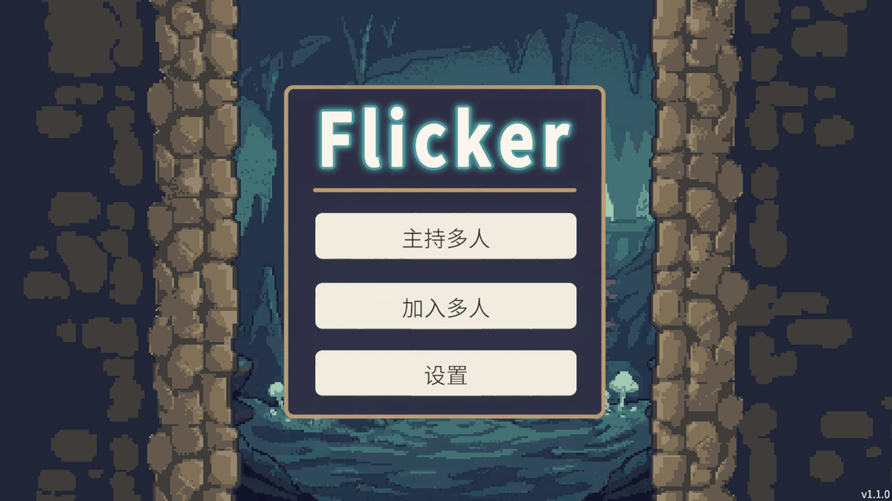
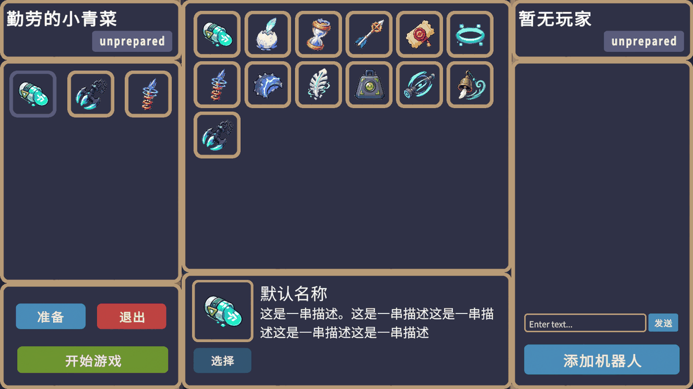
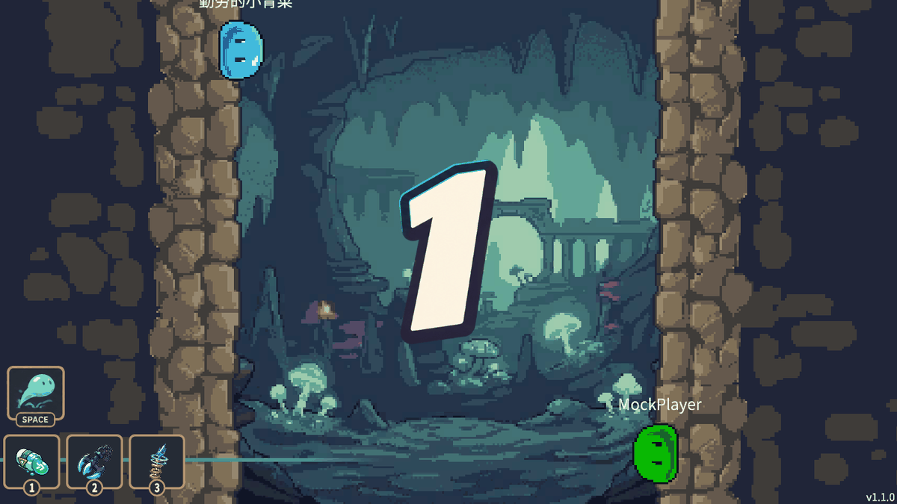
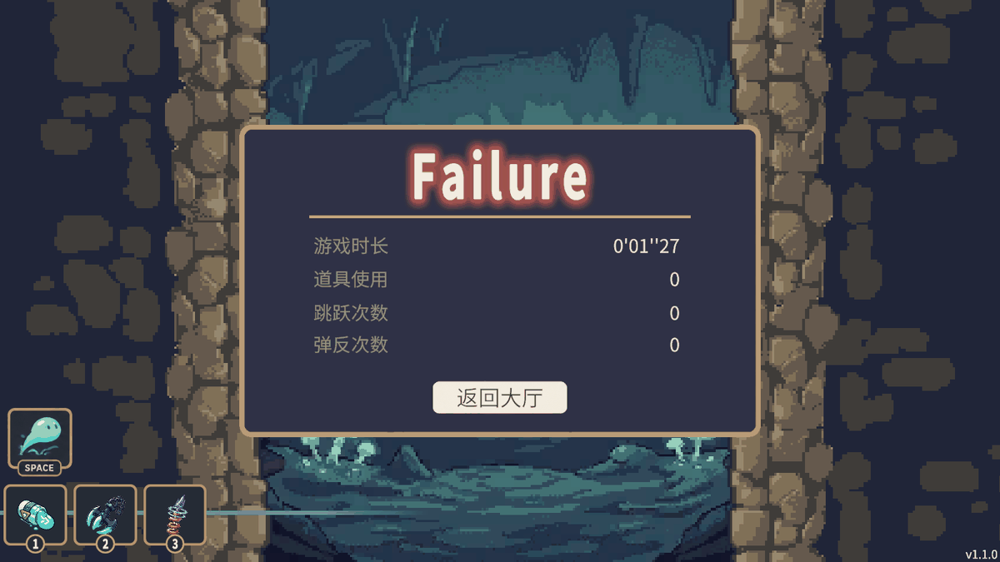
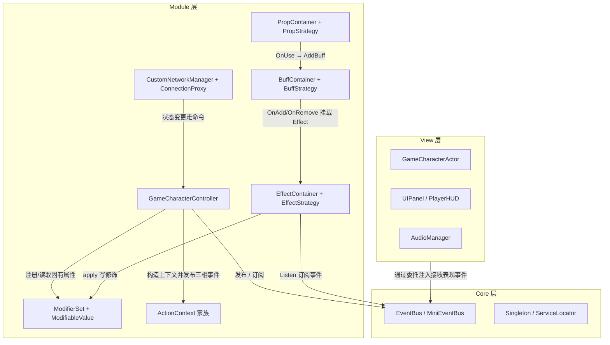

# Flicker

> 双人实时对抗的 2D 平台竞技游戏。两只史莱姆在两面竖直墙壁之间上下移动、跳跃踩踏对手，靠携带道具的博弈取胜。
>
> Unity 2022.3 · C# · Mirror 联机 · 单人 + 人机 + 双人联机

<p align="center">
  
  
  
</p>

<p align="center">
  
</p>

---

## 目录

- [玩法](#玩法)
- [操作](#操作)
- [技术亮点](#技术亮点)
- [架构设计](#架构设计)
- [项目结构](#项目结构)
- [运行方式](#运行方式)
- [已知限制](#已知限制)
- [开发历程](#开发历程)

---

## 玩法

一局两名玩家，各自贴在一面竖直墙壁上。

**核心循环**：纵向移动寻找距离 → 跳跃横跨到对面墙 → 途中踩中对手造成伤害 → 被踩后弹反可以反制。

不是落地踩踏，而是**飞行途中判定**。所以整个博弈发生在半空中：

- 你跳过去，对方可以跳走躲开
- 对方跳过来，你可以跳出去迎击
- 双方同时跳到中间，谁先到谁踩

**道具**是第二个变量。开局从道具池选三件携带，每件独立冷却，随时可用，但用了会进 CD。道具信息隐藏，通过信息差进行博弈。

### 道具一览（13 件）

| 道具       | 效果                                     |
| ---------- | ---------------------------------------- |
| 锚爪       | 跳跃途中折返，追加落地移速惩罚           |
| 补偿券     | 命中后惩罚对方道具 CD                    |
| 羽化孢子   | 追加落地移速惩罚                         |
| 空转轴     | 立刻重置道具获取冷却                     |
| 铅质稳定器 | 跳跃 CD 恢复惩罚                         |
| 轻质骨     | 跳跃 CD 恢复加速                         |
| 无名光环   | 与最远敌人交换位置                       |
| 不偏矢     | 弹反帧提前折返抵消，净效果为不换向       |
| 脉冲发条   | 沿当前方向冲刺固定距离，冲刺期间免疫攻击 |
| 逆流沙漏   | 冷却上限惩罚                             |
| 疾行凝胶   | 跳跃 CD 恢复惩罚                         |
| 静电甲壳   | 被弹反时为自身附加应激、为来源附加触电   |
| 借风铃     | 立刻无视 CD 起跳并取消本次攻击           |

---

## 操作

| 按键              | 动作                 |
| ----------------- | -------------------- |
| `Space`         | 跳跃（横跨到对面墙） |
| `↑` / `↓`   | 沿当前墙壁纵向移动   |
| `1` `2` `3` | 使用对应携带道具     |

大厅支持聊天输入，回车发送。

---

## 技术亮点

### 1. 三相事件 + 行为上下文

每个游戏行为拆成三个相位，共用同一个上下文实例：

```
BeforeXxx(context)   →  询问：本次行为是否发生（可写 cancelled）
XxxResult(context)   →  询问：本次行为是什么样（可写数值与参数）
AfterXxx(context)    →  通知：已按 context 执行完毕（只读）
```

**取消权只归 Before**。置 `cancelled = true` 后直接 return，后续两个相位都不发布。

这样设计的好处是：Buff/Effect 系统不需要知道任何具体行为的存在，只需订阅关心的相位。新增一个行为不需要改动任何现有效果代码。

上下文只装两类东西：

| 类别           | 类型                                | 例子                                       |
| -------------- | ----------------------------------- | ------------------------------------------ |
| 行为参数       | `bool` / `GameObject` / `int` | `toRightWall`、`victim`、`slotIndex` |
| 随事件产生的量 | `ModifiableValue`                 | `damage`                                 |

**固有属性一律不复制为字段**，统一经 `context.attributes.Final(Key.X)` 读取。

### 2. 修饰管线（PoE 式加区 / 乘区）

所有可修饰属性走同一套模型：

```
FinalValue = (base + Σadditive) × Π(1 + multiplier)
```

关键约束：**加区先汇总再统一相乘**，桶内归并保证结果与注册顺序无关。

管线每帧重算：

```
ModifyPipeline.GetModifierSet()
  → modifierSet.ClearModify()
  → effectContainer.ForEachEffect(e => e.Apply(modifierSet))
  → 返回共享实例
```

`ModifierSet` 用 `enum Key + Dictionary<Key, ModifiableValue>`。**键不存在时惰性补一个基值 0 的槽位** —— 这让"实体没有这个属性"变成正常状态而非异常：小怪没有 `PropContainer`，藏品给 `PropSlot` 加 1 只是写进一个无人读取的槽位，静默无效。

### 3. 冷却存比例而非绝对值

跳跃 CD、道具 CD 全部存 `0~1` 的比例，不存剩余秒数。

比例是上限的不变量 —— 上限被修饰时无需任何同步。这是移除整个 `MutableValue` 观察者机制的直接原因。

### 4. UI 与逻辑彻底解耦

逻辑层**严禁调用** `EventBus.Publish`，改为暴露 `Action` 委托字段，由 `PlayerController.Awake()` 统一注入：

```csharp
buffContainer.onBuffAdd    = (b) => EventTransmit<AddNewBuffEvent>(b);
propContainer.onPropUse    = (i) => EventTransmit<UsePropEvent>(i);
```

**验收标准：删掉所有 UI 代码，逻辑完全正常。**

Mirror 接入后，非本地玩家不注入即零开销切断 UI 事件流。

### 5. 轨迹操控

跳跃的轨迹状态全部在 `JumpContext` 里，由协程逐帧推进，效果层直接改字段干预：

```csharp
public bool toRightWall;   // 终点墙
public float hangTime;     // 进度换算系数
public float progress;     // 0 = 出发墙，1 = 终点墙

public void FoldBack()     // 折返：progress = 1-progress; toRightWall = !toRightWall
```

`FoldBack()` 是纯状态操作，**调用两次即完全还原**。所以"不偏矢"可以在弹反 Result 相位提前折返，抵消 GCC 里那次无条件折返，净效果为不换向 —— 不需要任何额外标志位。

**起点墙不单独存储**，由 `toRightWall` 推出，避免失同步。

### 6. 坐标轴归属

飞行与纵向位移各占一轴，互不抢占：

| 轴 | 归属                        |
| -- | --------------------------- |
| x  | 飞行插值只写 `position.x` |
| y  | `MoveAlongWall(deltaY)`   |

因此**半空冲刺成立** —— 跳跃途中纵向位移不会被飞行插值抹掉。

### 7. 网络架构

Mirror + KcpTransport。服务端权威，客户端只发命令：

```
客户端  Cmd*  →  服务端逻辑  →  EventBroadcast / TargetRpc  →  各端表现
```

UI 事件走 `EventBroadcast` → `connectionProxy.EventTransmit()`（`[TargetRpc]`），只发给真实客户端，**机器人不进 `connectionProxyWrappers`，因此 UI 转发对它们天然无效**。

大厅聊天同理：客户端只发正文，**发送者名由服务端从连接记录填入**，客户端无法冒充他人。

### 8. 表现层反馈

- **顿帧**：命中与弹反时 `Time.timeScale = 0` 持续 0.2s。Mirror 的 `NetworkTime` 用 `unscaledTimeAsDouble`，所以时间缩放不影响同步
- **全屏闪白**：Animator 设为 `Unscaled Time`，否则顿帧期间动画被冻结（这是踩过的坑）
- **音频**：双音源乒乓交叉淡化；音量滑条实时写音源，而不是每次 `PlayOneShot` 的系数
- **UI 点击音**：`IPointerDownHandler` 而非 `onClick`，按下即响；置灰按钮不发声

### 9. 人机 AI

三状态 FSM（追击 / 进攻 / 逃跑）+ 两级道具过滤：

```
第一级：道具意图   factoryId → PropIntent 位标志（Chase / Escape / Attack）
第二级：可用条件   距离、跳跃 CD、目标状态等动态判定
```

开局从四套预制卡组（追击 / 进攻 / 游走 / 消耗）随机挑一套。

---

## 架构设计



**分层约束**：逻辑层不引用任何 `Flicker.UI` 类型；UI 只做显示与收集输入，不驱动状态变更。

---

## 项目结构

```
Assets/Scripts/                   93 个文件 · 约 8000 行
├── Core/                         框架基础设施
│   ├── Singleton.cs              泛型单例
│   ├── EventBus.cs               静态全局总线（UI 事件 / 网络事件）
│   ├── MiniEventBus.cs           实例级总线（角色行为事件）
│   └── Utils.cs                  Ratio 比例换算 / NonlinearDamper
│
├── Module/                       核心游戏逻辑（64 文件）
│   ├── CharacterController/      GCC 基类 / PlayerController / MockController + FSM
│   ├── ModifiablePipeline/       ModifiableValue / ModifierSet / ModifyPipeline
│   ├── Buff/                     BuffContainer + 17 个 Buff 实现
│   ├── Effect/                   EffectContainer + Effect 实现
│   ├── PropCard/                 PropContainer / PropFactory + 13 个道具实现
│   ├── Event/                    ActionContext 家族 / CharacterEvent / UIEvent / ViewEvent
│   ├── Network/                  CustomNetworkManager / ConnectionProxy
│   ├── Input/                    IInput / KeyInput / FalseInput
│   └── LevelManager.cs           边界数据 / 关卡生命周期
│
├── UI/                           18 个文件
│   ├── UIManager.cs              面板堆栈管理（6 层 UILayer）
│   ├── UIPanel.cs                面板基类 + 按钮音效自动挂载
│   ├── UIButtonSfx.cs            按钮点击音
│   ├── Message.cs                聊天消息单元
│   └── Panels/                   10 个面板实现
│
└── View/                         4 个文件
    ├── SpriteActor.cs            精灵演员基类
    ├── GameCharacterActor.cs     动画状态切换 / 翻转
    ├── AudioManager.cs           音乐交叉淡化 / 音效叠加
    └── VibrationManager.cs       振动服务
```

---

## 运行方式

### 环境

| 项       | 版本                  |
| -------- | --------------------- |
| Unity    | 2022.3.62f3c1         |
| 渲染管线 | Built-in              |
| 网络     | Mirror + KcpTransport |
| TMP      | 3.0.7                 |

### 启动

1. 用 Unity 打开项目根目录
2. 打开场景 `Assets/Scenes/Gameplay.unity`
3. 点击 Play

### 三种模式

| 模式               | 操作                                                               |
| ------------------ | ------------------------------------------------------------------ |
| **人机**     | 主菜单 → 主持游戏 → 大厅点「添加机器人」→ 准备 → 开始          |
| **双人联机** | 主机：主持游戏拿到地址；客机：加入游戏填入地址；双方准备后主机开始 |
| **单人调试** | 主持游戏后直接开始（只生成一个角色）                               |

---

## 已知限制

这个项目是**玩法原型阶段**的完整可玩版本，不是商业成品。以下问题明确存在：

### 玩法层

1. **单局时长约 20 秒** —— 系统是按 2~3 分钟节奏设计的，但实际节奏没调到那个量级，进场到分出胜负很快。这是最核心的未解决问题
2. **AI 不好玩** —— 三状态 FSM 会追会跳会放道具，但不会骗招，也不会利用道具组合。能打，但不构成博弈
3. **道具没有独立 VFX** —— 只有 UI 图标、音效和 buff 栏反馈，道具释放瞬间缺少视觉表现
4. **没有成长 / 解锁系统** —— 道具池全开放，没有渐进曲线

### 工程层

5. **音效是临时素材** —— 未经混音处理，只是能用
6. **`PropContainer.onPropUse` 当前无订阅者**，但仍在每次用道具时发起一次 `TargetRpc`，属于可以省掉的双重开销
7. **`SetPlayerName` 在 `PlayerController` 和 `MockController` 中重复实现**
8. **`MockAttackState.Intent` 从未被读取** —— 进攻状态只存活一帧，`DecideProp` 拿不到它的意图，该属性目前是装饰性的
9. **聊天区 `Content` 的 `childControlWidth = false`** —— `Message` 宽度恒为 0，靠 `MessageBox` 的硬编码宽度才没露馅。一旦布局调整会错位
10. **`Sender` 的 `Auto Size` 仍开启** —— 当前布局下不受影响，但换布局方式可能导致高度跳变

### 美术层

11. **背景与墙面是像素风，角色是另一套密度** —— 风格不完全统一
12. **`dead_1~4` 是被插值放大过的糊图**（315 色 / 336 像素），不是干净的硬边像素画

---

## 开发历程

```
2026-06-23  init commit
    ↓
    玩法探索：跳跃踩踏、弹反、边界管理
    ↓
    修饰系统重构：三相加键值对
    ↓
    网络优先重构：Mirror 接入、命令与 TargetRpc 分流
    ↓
    道具改造：13 件道具、固定携带三件、独立冷却
    ↓
    人机模式：三状态 FSM + 两级道具过滤
    ↓
    音频 / 顿帧 / 全屏闪白 / 结算统计
    ↓
    UI 全量替换：硬边扁平风格
    ↓
    大厅聊天、倒计时音效
    ↓
2026-11-14  v1.1.0
```

**215 个提交**，其中 3 次大重构走独立分支后合并（网络优先、修饰系统、道具改造）。

完整开发过程见 `dev_Nekrosies` 分支；`master` 保留合并节点。

---

## 文档

| 文件                        | 内容                         |
| --------------------------- | ---------------------------- |
| `Doc/主策划案.md`         | 整体玩法设计                 |
| `Doc/设计哲学.md`         | 架构决策的来龙去脉           |
| `Doc/道具系统子策划案.md` | 13 件道具的详细设计          |
| `Doc/道具改造方案.md`     | 携带冷却制的改造记录         |
| `Doc/UI设计描述.md`       | UI 风格规范与各面板设计      |
| `Doc/修饰系统重构规划.md` | 三相事件与修饰管线的重构方案 |
| `Doc/联机优先重构规划.md` | Mirror 接入规划              |
| `AGENTS.md`               | 开发约定与架构速查           |
